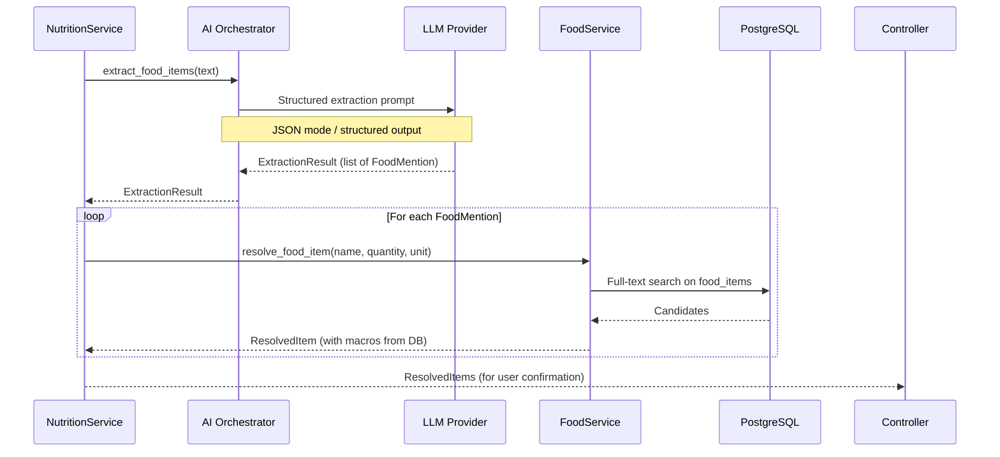
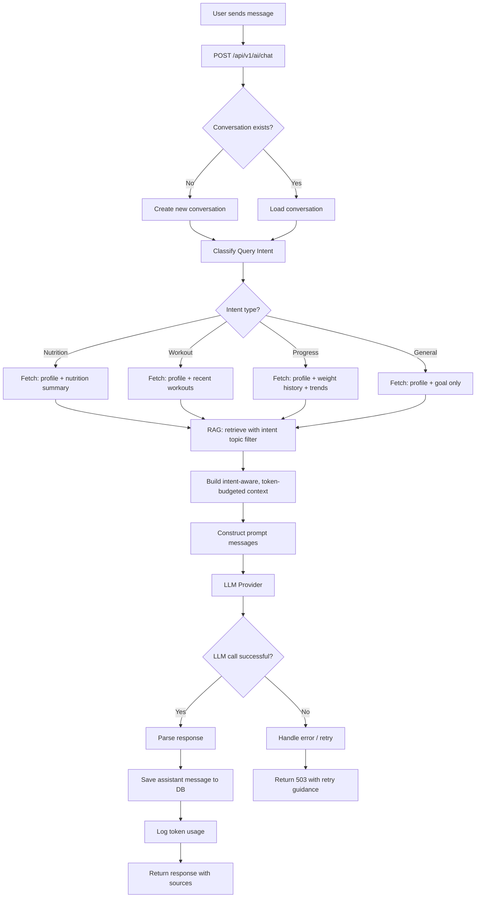
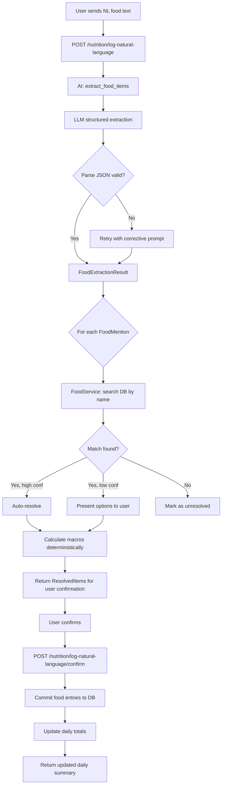

# AI Architecture
## AI-Powered Personalized Fitness & Nutrition Assistant

**Version:** 1.1  
**Status:** Draft — Phase 0 (Corrected)  
**Date:** 2026-09-10

---

## Table of Contents

1. [AI Subsystem Overview](#ai-subsystem-overview)
2. [Design Principles](#design-principles)
3. [LLM Provider Abstraction](#llm-provider-abstraction)
4. [Feature Breakdown](#feature-breakdown)
   - [Natural-Language Food Logging](#natural-language-food-logging)
   - [AI Assistant (General Chat)](#ai-assistant-general-chat)
   - [Nutrition Summary Generation](#nutrition-summary-generation)
   - [Personalized Recommendations](#personalized-recommendations)
5. [Prompt Architecture](#prompt-architecture)
6. [Context Construction](#context-construction)
7. [Structured Outputs](#structured-outputs)
8. [Conversation History Management](#conversation-history-management)
9. [Token Budget Management](#token-budget-management)
10. [Error Handling & Resilience](#error-handling--resilience)
11. [Cost Management](#cost-management)
12. [AI Safety Boundaries](#ai-safety-boundaries)
13. [Hybrid Personal + RAG Retrieval](#hybrid-personal--rag-retrieval)
14. [AI Flow Diagrams](#ai-flow-diagrams)

---

## 1. AI Subsystem Overview

The AI layer is responsible for:

| Feature | Type | LLM Role |
|---------|------|----------|
| Natural-language food logging | Extraction | Extract food + quantity from text |
| AI assistant | Generation | Answer questions with grounded context |
| Nutrition summary | Generation | Summarise user data in natural language |
| Meal suggestions | Generation | Explain pre-filtered meal options |
| Workout suggestions | Generation | Explain pre-filtered workout options |
| Progress analysis | Generation | Analyse user trends |

**Critical principle:** The LLM generates language, explains reasoning, and extracts structured data from text. It does not:
- Calculate calories or macros
- Retrieve user data from the database
- Make medical diagnoses
- Invent user history

---

## 2. Design Principles

### 2.1 LLM is a Reasoning Engine, Not a Data Store

```
WRONG:  Ask LLM "What are John's calories today?"
RIGHT:  Retrieve calories from DB → pass to LLM as context → LLM explains
```

### 2.2 Deterministic Before Generative

```
Deterministic:  calories remaining = target - consumed (SQL + Python)
Generative:     "You have 750 calories left — here's what you could eat tonight..."
```

### 2.3 Context is Ground Truth

The LLM is explicitly instructed that the context provided is authoritative. It must not supplement user data from its training knowledge.

### 2.4 Extraction is Separate from Calculation

The LLM extracts intent (`"3 eggs"` → `{food: "egg", quantity: 3, unit: "whole"}`). The backend resolves this to a food item, then calculates macros deterministically.

### 2.5 Graceful Degradation

If the LLM is unavailable, all non-AI features must continue working. AI endpoints return 503 with a clear message.

---

## 3. LLM Provider Abstraction

### Interface Design

```python
# app/ai/providers/base.py

class Message(BaseModel):
    role: Literal["system", "user", "assistant"]
    content: str

class LLMResponse(BaseModel):
    content: str
    prompt_tokens: int
    completion_tokens: int
    model: str
    finish_reason: str

class AbstractLLMProvider(ABC):
    """
    Abstract interface for LLM providers.
    Concrete implementations: OpenAIProvider, AnthropicProvider.
    Switching providers requires only a config change, not business logic changes.
    """

    @abstractmethod
    async def complete(
        self,
        messages: list[Message],
        temperature: float = 0.7,
        max_tokens: int = 1000,
        response_format: Literal["text", "json_object"] | None = None,
    ) -> LLMResponse:
        """Generate a completion."""
        ...

    @abstractmethod
    async def complete_structured(
        self,
        messages: list[Message],
        schema: type[BaseModel],
        temperature: float = 0.0,
    ) -> BaseModel:
        """Generate a structured output guaranteed to match schema."""
        ...
```

### Why This Matters

- If OpenAI raises prices, swap to Anthropic by changing one config value
- Providers can be tested with a `MockLLMProvider` without real API calls
- Token usage is captured uniformly regardless of provider

---

## 4. Feature Breakdown

### 4.1 Natural-Language Food Logging

**User input:** `"I had 3 scrambled eggs, 2 slices of wholegrain toast, and a cup of black coffee"`

**Flow:**



**Extraction schema (structured output):**

```json
{
  "food_mentions": [
    {
      "raw_text": "3 scrambled eggs",
      "food_name": "scrambled eggs",
      "quantity": 3,
      "unit": "whole",
      "confidence": "high"
    },
    {
      "raw_text": "2 slices of wholegrain toast",
      "food_name": "wholegrain bread",
      "quantity": 2,
      "unit": "slice",
      "confidence": "medium"
    },
    {
      "raw_text": "a cup of black coffee",
      "food_name": "black coffee",
      "quantity": 240,
      "unit": "ml",
      "confidence": "high"
    }
  ]
}
```

**Resolution:** The backend searches `food_items` using trigram similarity for each extracted `food_name`. The closest match is proposed to the user for confirmation. Macros are calculated from the DB record, not from the LLM.

**Why user confirmation step?**

The LLM may extract `"scrambled eggs"` but the DB may have `"Eggs, whole, cooked, scrambled"`. The user must confirm the match before entries are committed. This prevents silent data corruption.

---

### 4.2 AI Assistant (General Chat)

**Purpose:** Answer fitness/nutrition questions using grounded context (user data + RAG knowledge).

**Context assembly:**

```
System Prompt (role, boundaries, constraints)
    +
User Profile Summary (age, sex, height, current weight, goal)
    +
Today's Nutrition Summary (calories consumed, remaining, macro breakdown)
    +
Recent Workout Summary (last 3–5 workouts)
    +
RAG Context (top-5 retrieved knowledge chunks)
    +
Conversation History (last N messages within token budget)
    +
User Message
```

**Key instruction in system prompt:**
```
You have been provided with the user's actual fitness and nutrition data above.
Do NOT invent, estimate, or fabricate any numbers about the user's intake, weight, 
or workout history. Only refer to data explicitly provided in this context.
If data is not available, say so clearly.
```

---

### 4.3 Nutrition Summary Generation

**Triggered by:** User clicking "Analyse my day" or daily scheduled summary.

**Input to LLM:**
```json
{
  "date": "2026-09-10",
  "totals": { "calories": 1850, "protein_g": 112, "carbs_g": 195, "fat_g": 58 },
  "targets": { "calories": 2200, "protein_g": 165, "carbs_g": 220, "fat_g": 73 },
  "meals": {
    "breakfast": "420 kcal — oats, banana, protein shake",
    "lunch": "680 kcal — chicken, rice, broccoli",
    "snack": "450 kcal — Greek yogurt, almonds",
    "dinner": "300 kcal — eggs, toast"
  },
  "goal": "muscle_gain"
}
```

**LLM task:** Generate a natural-language summary highlighting progress, gaps, and actionable suggestions. The LLM must not recalculate the numbers; it receives them pre-calculated.

---

### 4.4 Personalized Recommendations

**Meal recommendation flow:**

```
1. [Deterministic] Calculate remaining calories, protein, carbs, fat for the day
2. [Deterministic] Multi-constraint candidate filtering:
   a. Calorie constraint: estimated serving calories <= remaining_calories (with tolerance)
   b. Protein constraint: prioritise items contributing to protein deficit
   c. Macro composition: filter items whose macro ratios are compatible with remaining targets
   d. Dietary restrictions: exclude items violating user restrictions (vegetarian, gluten_free, etc.)
   e. Serving-size suitability: include only items with realistic serving sizes
   f. Food diversity: reduce recency bias (items logged many times recently are deprioritised)
3. [Deterministic] Score and rank candidates by multi-objective scoring:
   score = w1*protein_contribution + w2*calorie_fit + w3*macro_balance - w4*recency_penalty
4. [RAG] Retrieve relevant meal/nutrition knowledge
5. [LLM] Select from pre-filtered, pre-ranked list; group into meal compositions; explain choices
6. Return: structured suggestions with explanations
```

**Key principle:** The LLM never invents the candidate foods and never decides the calorie or macro values — it selects from a pre-filtered, deterministically scored list and explains the choices in natural language. All nutritional figures used in the response come from the database.

**Workout recommendation flow:**

```
1. [Deterministic] Retrieve recent workout sessions (last 7–14 days)
2. [Deterministic] Identify muscle groups trained recently per session, with timestamps
3. [Deterministic] Compute a per-muscle-group recency score based on:
   - Sessions since last trained (days elapsed)
   - Volume trained (sets × reps, relative intensity if tracked)
   Note: This is a configurable heuristic, not a universal rule.
   Recovery time is influenced by training volume, intensity, exercise selection,
   sleep, nutrition, and individual variation. The system uses elapsed time + volume
   as a practical proxy, with sensible defaults that can be adjusted.
4. [Deterministic] Filter exercises matching:
   - User's active goal type (hypertrophy, endurance, maintenance)
   - Available equipment (if specified in profile)
   - Muscle groups with higher recency scores (i.e., more time since last trained)
5. [RAG] Retrieve relevant training methodology knowledge for context
6. [LLM] Suggest workout structure, explain rationale, cite factors that influenced the recommendation
```

**Recovery note for the LLM prompt:** The system prompt instructs the LLM to acknowledge that recovery is individual and influenced by many factors. It must not present any specific time window as a universal recovery rule.

---

## 5. Prompt Architecture

### 5.1 Prompt Organisation

All prompts are version-controlled Python modules in `app/ai/prompts/`. No prompts in configuration files or databases (that makes versioning and testing harder).

```
app/ai/prompts/
├── system_prompts.py          # Core system prompt
├── food_extraction.py         # NL food extraction
├── nutrition_summary.py       # Daily nutrition analysis
├── recommendations.py         # Meal and workout suggestions
└── assistant.py               # General assistant prompt
```

### 5.2 System Prompt Structure

```
[Persona]
You are a knowledgeable fitness and nutrition assistant...

[Scope Boundaries]
You assist with: fitness tracking, nutrition guidance, workout planning...
You do NOT: provide medical advice, diagnose conditions, prescribe medication...

[Data Integrity Rule]
The user context below is authoritative. Do not invent user data...

[Response Format]
Be concise, evidence-based, and encouraging. Cite sources when using knowledge base content...

[Safety]
If a user asks about medical conditions, eating disorders, or symptoms, 
direct them to consult a qualified healthcare professional...
```

### 5.3 Prompt Testing

Each prompt module includes:
- Unit tests for the prompt builder function
- Golden-set tests (known input → expected output structure)
- Edge case tests (empty context, missing data)

---

## 6. Context Construction

### 6.1 Intent-Aware Context Selection

Context is not injected uniformly across all AI requests. The calling service determines **query intent** and selects only the data sources relevant to that intent. This prevents irrelevant data from consuming token budget and avoids surfacing data the user didn’t ask about.

| Query Intent | SQL Data Sources Fetched | RAG Topic Filter |
|-------------|-------------------------|------------------|
| Nutrition question | Profile, active goal, today’s nutrition summary | `['nutrition', 'meal_planning']` |
| Workout question | Profile, active goal, recent workout history | `['training', 'cardio', 'recovery']` |
| Weight/progress question | Profile, weight history (last 30 days), nutrition trend, workout summary | `['weight_management', 'nutrition', 'training']` |
| General knowledge question | Profile, active goal only | No filter (all categories) |
| Meal recommendation | Profile, active goal, today’s nutrition summary, remaining macros | `['nutrition', 'meal_planning']` |
| Workout recommendation | Profile, active goal, recent workout history (last 14 days) | `['training', 'cardio', 'recovery']` |
| Daily summary analysis | Profile, active goal, today’s full nutrition breakdown, today’s workout | `['nutrition', 'training']` |

Intent classification is performed by the calling service before invoking the orchestrator. For general chat, the service uses a lightweight intent classifier (either keyword-based or a cheap LLM call) to route the request to the correct context assembly path.

### 6.2 Context Builder

```python
# app/ai/context/builder.py

class AIContextBuilder:
    def build(
        self,
        user_profile: UserProfile,
        goals: list[FitnessGoal],
        intent: QueryIntent,                          # NEW: drives selective loading
        nutrition_summary: DailyNutritionSummary | None = None,   # Only if intent needs it
        weight_history: list[WeightEntry] | None = None,          # Only if intent needs it
        recent_workouts: list[WorkoutSummary] | None = None,      # Only if intent needs it
        rag_chunks: list[RetrievedChunk] | None = None,
        conversation_history: list[AIMessage] | None = None,
        budget: TokenBudget | None = None,
    ) -> str:
        budget = budget or TokenBudget(max_context_tokens=4000)
        sections = []

        # Always include: concise profile + active goal
        sections.append(self._format_profile(user_profile, goals))

        # Conditionally include based on intent
        if nutrition_summary and budget.can_fit("nutrition"):
            sections.append(self._format_nutrition(nutrition_summary))
            budget.consume("nutrition", estimated_tokens=200)

        if weight_history and budget.can_fit("weight"):
            sections.append(self._format_weight_history(weight_history))
            budget.consume("weight", estimated_tokens=150)

        if recent_workouts and budget.can_fit("workouts"):
            sections.append(self._format_workouts(recent_workouts))
            budget.consume("workouts", estimated_tokens=150)

        if rag_chunks and budget.can_fit("rag"):
            sections.append(self._format_rag(rag_chunks))
            budget.consume("rag", estimated_tokens=len(rag_chunks) * 200)

        return "\n\n".join(sections)
```

**Why not always inject everything?**
- Irrelevant context dilutes the signal and can cause the LLM to reference data the user didn’t ask about.
- Selective loading keeps token cost lower and response quality higher.
- It avoids leaking sensitive (though owned) data (e.g., weight history) into a conversation about a general knowledge topic.

### 6.3 Context Priority (when budget is tight)

If the token budget is tight, context is trimmed in this order (lowest priority first):

1. Old conversation history (keep last 3–5 turns)
2. Less-relevant RAG chunks (keep top 3 if budget constrained)
3. Detailed workout history (keep summary only)
4. Detailed meal breakdown (keep daily totals only)
5. **Never remove:** user profile, active goal

---

## 7. Structured Outputs

### 7.1 Food Extraction Schema

```python
class FoodMention(BaseModel):
    raw_text: str
    food_name: str
    quantity: float
    unit: str  # "whole", "g", "ml", "slice", "cup", etc.
    confidence: Literal["high", "medium", "low"]

class FoodExtractionResult(BaseModel):
    food_mentions: list[FoodMention]
    ambiguous: list[str]  # Text fragments that couldn't be parsed
```

### 7.2 Meal Recommendation Schema

```python
class MealSuggestionItem(BaseModel):
    food_name: str
    quantity_g: float
    rationale: str

class MealSuggestion(BaseModel):
    name: str
    description: str
    items: list[MealSuggestionItem]
    estimated_calories: float  # For display only; actual will be recalculated from DB
    estimated_protein_g: float
    why_recommended: str

class MealRecommendationResult(BaseModel):
    suggestions: list[MealSuggestion]
    general_advice: str
```

**Note:** `estimated_calories` from the LLM is for display only. When the user logs the suggestion, actual macros are re-derived from the food database.

---

## 8. Conversation History Management

### 8.1 Storage

All conversations stored in `ai_conversations` + `ai_messages` tables. Each user can have multiple conversations.

### 8.2 History Injection Strategy

Conversation history is injected in chronological order (oldest to newest). The last N turns are included, where N is determined by the token budget.

```python
def get_conversation_messages(
    history: list[AIMessage],
    max_tokens: int = 1500,
) -> list[Message]:
    messages = []
    token_count = 0

    # Iterate from newest to oldest, add until budget exhausted
    for msg in reversed(history):
        estimated = len(msg.content) // 4  # ~4 chars per token
        if token_count + estimated > max_tokens:
            break
        messages.insert(0, Message(role=msg.role, content=msg.content))
        token_count += estimated

    return messages
```

### 8.3 Conversation Context Types

| Type | Description | Context Included |
|------|-------------|-----------------|
| `general` | General fitness/nutrition questions | Profile, goals, recent data |
| `nutrition` | Focused on today's nutrition | Profile, today's full nutrition data |
| `workout` | Focused on workouts | Profile, recent workout history |
| `progress` | Progress analysis | Profile, weight history, trends |

---

## 9. Token Budget Management

### 9.1 Budget Allocation (Example for GPT-4o-mini, 16K context)

| Section | Budget (tokens) | Priority |
|---------|----------------|----------|
| System prompt | 400 | Fixed |
| User profile + goal | 200 | High |
| Today's nutrition | 200 | High |
| Recent workouts | 150 | Medium |
| RAG context (5 chunks) | 1500 | Medium |
| Conversation history | 1500 | Lower |
| User message | 500 | Fixed |
| Response | 1000 | Fixed |
| **Total** | **5,450** | Well within 16K |

### 9.2 Adaptive Budgeting

If a user sends a very long message (500+ tokens), reduce history or RAG context proportionally. The system prompt and profile are never compressed.

---

## 10. Error Handling & Resilience

### 10.1 LLM Failure Modes

| Failure | Handling |
|---------|----------|
| Rate limit (429) | Exponential backoff, 3 retries, then 503 |
| Timeout | Single retry with increased timeout, then 503 |
| Content filter | Return user-friendly message; log the flagged content |
| Invalid JSON (structured output) | Retry once with stricter prompt; then return parsing error |
| Token limit exceeded | Truncate context, retry; log the truncation |

### 10.2 Fallback Strategy

If the AI service is unavailable:
- All non-AI features continue normally
- AI endpoints return: `{"error": "AI assistant temporarily unavailable", "retry_after": 30}`
- Logged food entries from NL logging that couldn't be processed are saved as drafts

### 10.3 Structured Output Validation

After receiving a structured response, always validate with Pydantic:

```python
try:
    result = FoodExtractionResult.model_validate(llm_response_dict)
except ValidationError as e:
    logger.warning("llm_structured_output_invalid", error=str(e))
    # Retry with corrective prompt or return error
    raise AIServiceError("Failed to parse food extraction response")
```

---

## 11. Cost Management

### 11.1 Cost Control Mechanisms

| Mechanism | Implementation |
|-----------|---------------|
| Rate limiting per user | 20 AI requests/minute |
| Token logging | Log prompt + completion tokens per request |
| Model selection | Use `gpt-4o-mini` for extraction tasks; reserve GPT-4 for complex analysis |
| Context compression | Summarise old conversation history rather than dumping raw messages |
| Caching | Cache identical food extraction results for identical inputs (Redis; optional) |
| Daily limits | Soft limit: warn user at 50 AI interactions/day (configurable) |

### 11.2 Token Cost Monitoring

```python
# After each LLM call
await usage_logger.log(
    user_id=user_id,
    feature=feature_name,
    model=response.model,
    prompt_tokens=response.prompt_tokens,
    completion_tokens=response.completion_tokens,
    estimated_cost_usd=calculate_cost(response),
)
```

---

## 12. AI Safety Boundaries

### 12.1 In-Scope Topics

- General fitness and exercise guidance
- Nutrition information (macronutrients, meal planning, food choices)
- Weight management (caloric deficit/surplus concepts)
- Muscle building and recovery principles
- Hydration and sleep hygiene basics
- Interpreting the user's own tracked data

### 12.2 Out-of-Scope Topics (System Prompt Boundaries)

| Topic | Response |
|-------|----------|
| Medical diagnoses | "I'm not a medical professional. Please consult a doctor." |
| Prescription medications | Decline; refer to doctor |
| Eating disorder symptoms | Express concern; provide crisis resources |
| Severe caloric restriction (<1000 kcal) | Warn user; encourage professional consultation |
| Supplement dosages beyond common ranges | Note they should consult a professional |
| Specific injury treatment | Refer to physiotherapist or doctor |

### 12.3 Disclaimer

All AI responses include or are preceded by a persistent UI disclaimer:

> "This AI assistant provides general fitness and nutrition guidance. It is not a substitute for professional medical or dietitian advice."

---

## 13. Hybrid Personal + RAG Retrieval

### 13.1 What Comes From SQL

| Data | Source | How Retrieved |
|------|--------|---------------|
| User profile | `user_profiles` | By `user_id` |
| Active goals | `fitness_goals` | Filter `status='active'` |
| Today's nutrition | `food_entries` | Filter `log_date=today`, `user_id` |
| Weight history | `weight_entries` | Last 14–30 days, by `user_id` |
| Recent workouts | `workout_sessions` + children | Last 5, by `user_id` |
| Conversation history | `ai_messages` | By `conversation_id` |

All of this is assembled by the calling service before passing to the AI orchestrator. The AI module never queries the database.

### 13.2 What Comes From Vector Search

| Data | Source | How Retrieved |
|------|--------|---------------|
| Domain knowledge | `document_chunks` via pgvector | Semantic similarity to user query |

### 13.3 How Contexts Are Combined

The orchestrator receives only the context sources relevant to the query intent. The calling service is responsible for intent classification and selective SQL fetching before invoking the orchestrator.

```python
# app/ai/orchestrator.py
async def chat(
    self,
    message: str,
    conversation_id: UUID,
    intent: QueryIntent,            # Classified by calling service
    user_context: UserContext,      # Intent-selective: only relevant data fetched
    rag_chunks: list[RetrievedChunk],  # Intent-filtered: only relevant topic categories
) -> AIResponse:

    system_prompt = build_system_prompt()

    context_block = self.context_builder.build(
        user_profile=user_context.profile,
        goals=user_context.goals,
        intent=intent,
        nutrition_summary=user_context.nutrition_summary,   # None if not relevant
        weight_history=user_context.weight_history,         # None if not relevant
        recent_workouts=user_context.recent_workouts,       # None if not relevant
        rag_chunks=rag_chunks,
        conversation_history=user_context.conversation_history,
    )

    messages = [
        Message(role="system", content=f"{system_prompt}\n\n{context_block}"),
        *self._format_history(user_context.conversation_history),
        Message(role="user", content=message),
    ]

    response = await self.provider.complete(messages)
    return AIResponse(content=response.content, sources=rag_chunks)
```

### 13.4 Preventing LLM from Inventing User Data

The system prompt includes an explicit instruction block:

```
STRICT DATA INTEGRITY RULE:
The user's personal data section above is the ONLY source of truth for 
the user's actual numbers (weight, calories, protein intake, workout history).

DO NOT:
- Estimate what the user's intake might be
- Invent workout sessions not listed
- Assume goals the user hasn't set
- Use general population averages as if they were the user's specific data

If data is not in the context, respond: "I don't have data on that for you."
```

### 13.5 Source Attribution in Responses

When the LLM generates a response that uses RAG context, the sources are returned to the frontend:

```json
{
  "response": "Based on energy balance principles, a consistent caloric deficit of 300-500 kcal/day...",
  "sources": [
    {
      "document_title": "Energy Balance and Body Composition",
      "section": "Caloric Deficit for Fat Loss",
      "similarity_score": 0.92
    }
  ]
}
```

The UI displays these as expandable citations below the response.

---

## 14. AI Flow Diagrams

### AI Chat Full Flow



### Food Extraction Flow


