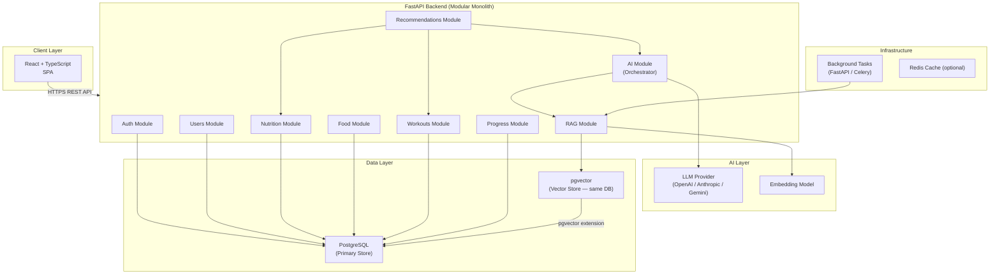
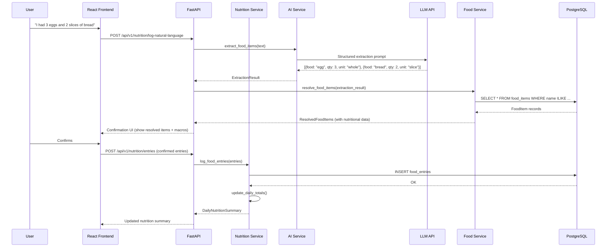
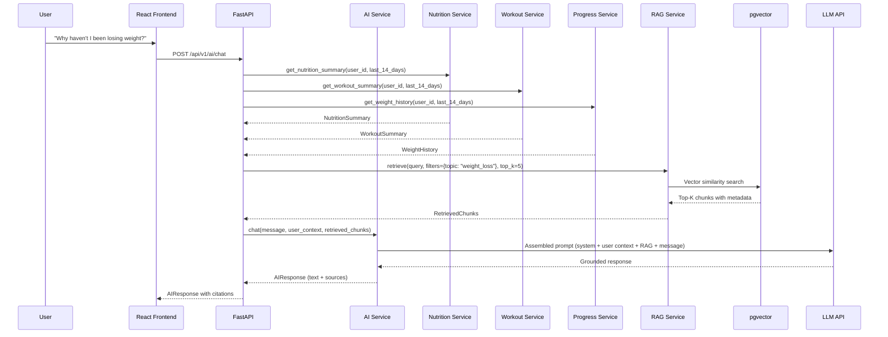

# System Architecture
## AI-Powered Personalized Fitness & Nutrition Assistant

**Version:** 1.0  
**Status:** Draft — Phase 0  
**Date:** 2026-09-10

---

## Table of Contents

1. [Architecture Overview](#architecture-overview)
2. [Why Modular Monolith](#why-modular-monolith)
3. [High-Level Architecture Diagram](#high-level-architecture-diagram)
4. [Module Boundaries](#module-boundaries)
5. [Module Communication](#module-communication)
6. [Data Flow Diagrams](#data-flow-diagrams)
7. [Technology Stack Justification](#technology-stack-justification)
8. [Future Extraction Points](#future-extraction-points)
9. [Architecture Review](#architecture-review)

---

## 1. Architecture Overview

The system is a **modular monolith** — a single deployable unit with clear internal module boundaries. The backend is a FastAPI application that acts as:

1. The primary API server serving the React frontend
2. The AI orchestration layer
3. The RAG pipeline coordinator

This avoids the operational complexity of microservices while preserving the ability to extract services later if load or complexity justifies it.

---

## 2. Why Modular Monolith

### Arguments for Modular Monolith

| Factor | Analysis |
|--------|----------|
| **Team size** | Solo or small team — microservices add network, deployment, and coordination overhead |
| **Domain maturity** | The domain is understood but the data contracts are still being discovered; hard module boundaries are premature |
| **Portfolio clarity** | A well-designed modular monolith is more legible to interviewers than a sprawling microservice mesh |
| **Infrastructure cost** | Single deployable unit; no service mesh, no inter-service auth, no distributed tracing infrastructure |
| **Development velocity** | In-process calls; no network latency, serialisation overhead, or partial failure states between services |
| **AI integration** | LLM and RAG pipelines need access to the same database; forcing them into a separate process adds latency and complexity without benefit |

### Arguments Against (and Rebuttals)

| Concern | Rebuttal |
|---------|----------|
| "AI workloads should be isolated" | AI calls are already isolated by being async; physical separation is not required |
| "RAG ingestion could block the API" | Background tasks (FastAPI BackgroundTasks or Celery) handle this without a separate service |
| "Scaling AI independently" | At portfolio scale, this is not relevant. The abstraction layer allows extraction later |

### When to Extract

Extract a module to a microservice only when:
- Independent scaling is economically justified
- The team is large enough to own the service boundary
- The domain has stabilised enough that the API contract will not change frequently
- The benefit of isolation outweighs the operational cost

**Recommended extraction candidates** (not now, but designed for it):
- RAG ingestion pipeline → if document volume becomes large and ingestion becomes a separate operational concern
- Embedding generation → if a different embedding model/provider is used that requires a separate runtime

---

## 3. High-Level Architecture Diagram



---

## 4. Module Boundaries

### 4.1 Auth Module
**Responsibility:** Authentication and authorisation only.  
**Does NOT:** Contain user profile logic, access business data directly.  
**Exposes:** Token issuance, token validation, password management.  
**Dependency:** Users module (to look up users by email).

### 4.2 Users Module
**Responsibility:** User account management, profile, and preferences.  
**Does NOT:** Calculate nutrition targets (that belongs to Nutrition module).  
**Exposes:** User profile CRUD, preference management.  
**Dependency:** None (root module).

### 4.3 Nutrition Module
**Responsibility:** Food logging, meal management, daily nutrition totals, target comparison.  
**Does NOT:** Make LLM calls directly; delegates to AI module for NL processing.  
**Exposes:** Food entry CRUD, daily summary, target delta calculation.  
**Dependency:** Food module (food item lookup), Users module (targets).

### 4.4 Food Module
**Responsibility:** Food item database, serving sizes, search.  
**Does NOT:** Log entries (that belongs to Nutrition module).  
**Exposes:** Food item search, food item CRUD.  
**Dependency:** None.

### 4.5 Workouts Module
**Responsibility:** Workout sessions, exercise logging, exercise database.  
**Does NOT:** Make LLM calls directly.  
**Exposes:** Workout CRUD, exercise database search.  
**Dependency:** None (self-contained).

### 4.6 Progress Module
**Responsibility:** Body weight history, progress aggregation, trend calculation.  
**Does NOT:** Calculate nutrition (read-only from Nutrition module for trend data).  
**Exposes:** Weight logging, weight history, analytics aggregates.  
**Dependency:** Nutrition module (read), Workouts module (read).

### 4.7 Recommendations Module
**Responsibility:** Orchestrate deterministic filtering + AI reasoning for personalised recommendations.  
**Does NOT:** Store recommendation history (ephemeral, generated on demand).  
**Exposes:** Meal suggestions, workout suggestions.  
**Dependency:** Nutrition module, Workouts module, AI module.

### 4.8 AI Module
**Responsibility:** LLM orchestration, prompt construction, context assembly, conversation management, response parsing.  
**Does NOT:** Access food/workout databases directly; receives context from calling modules.  
**Exposes:** `chat()`, `extract_food_items()`, `generate_summary()`, `generate_recommendations()`.  
**Dependency:** RAG module (retrieval), Users module (context).

### 4.9 RAG Module
**Responsibility:** Document ingestion, chunking, embedding, vector storage, semantic retrieval.  
**Does NOT:** Make LLM calls for generation; only for embedding.  
**Exposes:** `retrieve()`, `ingest_document()`, `delete_document()`.  
**Dependency:** pgvector (vector storage), Embedding model.

---

## 5. Module Communication

### 5.1 Communication Pattern

All module communication is **in-process function calls** (Python imports). No HTTP calls between modules.

```
Service Layer calls Service Layer
    ↓
Repository Layer calls DB only
```

### 5.2 Dependency Rules

```
API Routes → Services → Repositories → Database
API Routes → Services → Other Services (allowed, limited)
Services → AI Module (inject as dependency)
AI Module → RAG Module (inject as dependency)
```

**Forbidden:**
- Repositories calling other repositories directly
- Routes calling repositories directly (bypass service layer)
- AI module querying the database directly

### 5.3 Context Passing Pattern

When the AI module needs user data, the **calling service** retrieves the structured data from the database and passes it as a pre-assembled context object to the AI module. The AI module does not have database access.

```python
# Correct pattern
user_context = await nutrition_service.build_user_context(user_id)
ai_response = await ai_service.chat(message, user_context=user_context)

# Incorrect pattern (AI module should NOT do this)
# ai_response = await ai_service.chat(message, user_id=user_id)
# ...where AI module then queries the DB itself
```

---

## 6. Data Flow Diagrams

### 6.1 Natural-Language Food Logging



### 6.2 Hybrid RAG + Personal Data Query



---

## 7. Technology Stack Justification

### 7.1 React + TypeScript (Frontend)
**Decision:** Confirmed appropriate.  
**Rationale:** Industry-standard SPA framework; TypeScript adds compile-time safety; strong ecosystem for charting (Recharts, Chart.js), forms, and state management (Zustand or React Query).

### 7.2 FastAPI (Backend)
**Decision:** Confirmed appropriate.  
**Rationale:** Native async support aligns with I/O-heavy AI API calls; automatic OpenAPI generation; Pydantic-first validation; growing industry adoption for AI backends.

### 7.3 PostgreSQL (Primary Database)
**Decision:** Confirmed appropriate.  
**Rationale:** Mature ACID-compliant database; excellent for relational fitness/nutrition data; supports pgvector extension eliminating the need for a separate vector DB.

### 7.4 pgvector (Vector Storage)
**Decision:** Confirmed. Recommended over separate vector database.  
**Rationale:** At portfolio scale (< 100K document chunks), pgvector in PostgreSQL provides sufficient performance. Eliminates a separate infrastructure component (Pinecone, Weaviate, Qdrant). Simplifies deployment, reduces cost, and allows transactional consistency between metadata and vectors.  
**When to reconsider:** If knowledge base exceeds ~1M chunks, or if advanced vector DB features (multi-tenancy, hybrid search primitives, ANN at massive scale) are required.

### 7.5 LLM API (AI Provider)
**Decision:** Abstracted provider; OpenAI recommended as initial implementation.  
**Rationale:** OpenAI provides function calling, structured outputs (JSON mode), and is well-documented. The abstraction layer allows switching to Anthropic (Claude) or Google (Gemini) without changing business logic.

---

## 8. Future Extraction Points

| Component | Extraction Trigger | Proposed Service |
|-----------|-------------------|------------------|
| RAG Ingestion | Document volume > 100K; ingestion becomes operational concern | Document Ingestion Service |
| Embedding Generation | Different model/provider requiring separate runtime | Embedding Microservice |
| Background Workers | Job queue depth becomes a bottleneck | Celery + Redis workers |
| Notifications | Push notifications for goals, reminders | Notification Service |

**NOT recommended for extraction:**
- Auth (security-critical; extract only to a mature identity provider like Auth0)
- Nutrition/Workout tracking (core business logic; tightly coupled to DB)
- AI Orchestration (too dependent on user data access patterns)

---

## 9. Architecture Review

### Identified Risks and Mitigations

| Risk | Severity | Mitigation |
|------|----------|------------|
| AI module grows too large | Medium | Enforce single responsibility: AI module orchestrates, does not contain business logic |
| LLM latency degrades UX | High | Streaming responses; optimistic UI updates; AI features clearly non-blocking |
| pgvector performance at scale | Low (portfolio) | HNSW index on embedding column; evaluate IVFFlat if needed |
| Nutrition data inaccuracy from LLM | High | Strict separation: LLM extracts intent, DB provides numbers, deterministic code calculates |
| Prompt injection | Medium | Server-side prompt construction; input sanitisation; content filtering |
| Module coupling creep | Medium | Enforce dependency rules in code review; services inject repositories, not other services' repositories |
| Context size explosion | Medium | Token budget management; summarise historical data rather than raw-dumping it |

### What This Architecture Demonstrates (Portfolio Value)

- Clean layered architecture (API → Service → Repository)
- Domain-driven module boundaries
- Hybrid AI + deterministic computation
- RAG pipeline design
- Security-conscious design (auth isolation, service-layer authorization)
- Database design with proper normalization
