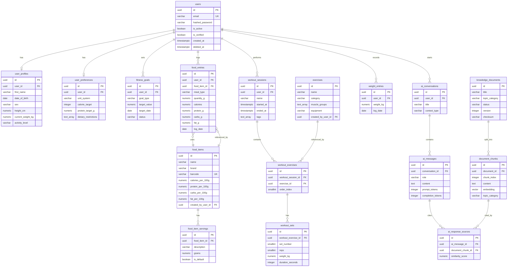

# Database Design
## AI-Powered Personalized Fitness & Nutrition Assistant

**Version:** 1.1  
**Status:** Draft — Phase 0 (Corrected)  
**Date:** 2026-09-10

---

## Table of Contents

1. [Design Principles](#design-principles)
2. [Entity Reference](#entity-reference)
3. [Schema Definitions](#schema-definitions)
4. [USDA FoodData Central Integration](#usda-fooddata-central-integration)
5. [Entity Relationship Diagram](#entity-relationship-diagram)
6. [Normalization Rationale](#normalization-rationale)
7. [Indexing Strategy](#indexing-strategy)
8. [pgvector Schema](#pgvector-schema)
9. [Soft Deletion Strategy](#soft-deletion-strategy)
10. [Historical Data Storage](#historical-data-storage)
11. [Referential Integrity](#referential-integrity)
12. [Database Conventions](#database-conventions)

---

## 1. Design Principles

1. **Data integrity first** — nutritional values stored in `food_items` are sourced from USDA FoodData Central and are the best available reference data at time of import. They are not guaranteed to be universally accurate (serving sizes, preparation methods, and measurement conventions vary), but they are deterministic and consistently applied. All application calculations are performed by Python code, not by the LLM.
2. **Normalised where appropriate** — avoid redundant data in frequently written tables; allow measured denormalisation for read-heavy analytics paths.
3. **Audit trail** — `created_at` and `updated_at` on all major tables.
4. **Soft deletion** — user-facing records use `deleted_at` rather than hard deletes to preserve audit history.
5. **Explicit foreign keys** — all relationships enforced at the database level, not only at the application level.
6. **User isolation** — all user-owned data includes `user_id` foreign key. Queries must always filter by `user_id`.
7. **Single source of truth per fact** — where two fields could represent the same datum, exactly one is authoritative and the other is explicitly a derived snapshot. See weight and food-entry provenance rules below.
8. **Extensibility** — design for known future features (micronutrients, workout templates) without speculative tables.

---

## 2. Entity Reference

| Entity | Table | Purpose |
|--------|-------|---------|
| User | `users` | Authentication credentials |
| UserProfile | `user_profiles` | Physical attributes, demographics |
| UserPreference | `user_preferences` | App settings and AI preferences |
| FitnessGoal | `fitness_goals` | User fitness objectives |
| FoodItem | `food_items` | Food nutrition database |
| FoodItemServing | `food_item_servings` | Serving size variants per food |
| FoodEntry | `food_entries` | Individual food log entries |
| Exercise | `exercises` | Exercise database |
| WorkoutSession | `workout_sessions` | A single workout session |
| WorkoutExercise | `workout_exercises` | Exercises within a session |
| WorkoutSet | `workout_sets` | Individual sets within an exercise |
| WeightEntry | `weight_entries` | Body weight history |
| AIConversation | `ai_conversations` | AI chat conversation threads |
| AIMessage | `ai_messages` | Individual messages in a conversation |
| KnowledgeDocument | `knowledge_documents` | RAG source documents |
| DocumentChunk | `document_chunks` | Chunked document segments + embeddings |
| AIResponseSource | `ai_response_sources` | Citation tracking for RAG responses |

---

## 3. Schema Definitions

### 3.1 users

**Purpose:** Stores authentication credentials only. No profile data.

| Column | Type | Constraints | Notes |
|--------|------|-------------|-------|
| `id` | UUID | PRIMARY KEY, DEFAULT gen_random_uuid() | |
| `email` | VARCHAR(255) | UNIQUE, NOT NULL | Normalised to lowercase |
| `hashed_password` | VARCHAR(255) | NOT NULL | bcrypt hash |
| `is_active` | BOOLEAN | NOT NULL, DEFAULT TRUE | Account enabled flag |
| `is_verified` | BOOLEAN | NOT NULL, DEFAULT FALSE | Email verification |
| `created_at` | TIMESTAMPTZ | NOT NULL, DEFAULT now() | |
| `updated_at` | TIMESTAMPTZ | NOT NULL, DEFAULT now() | |
| `deleted_at` | TIMESTAMPTZ | NULLABLE | Soft delete |

**Indexes:**
- UNIQUE on `email` (login lookup)
- INDEX on `is_active` (filter inactive accounts)

---

### 3.2 user_profiles

**Purpose:** Physical attributes used for calorie/macro target calculation.

| Column | Type | Constraints | Notes |
|--------|------|-------------|-------|
| `id` | UUID | PRIMARY KEY | |
| `user_id` | UUID | FK → users.id, UNIQUE, NOT NULL | One profile per user |
| `first_name` | VARCHAR(100) | NOT NULL | |
| `last_name` | VARCHAR(100) | NULLABLE | |
| `date_of_birth` | DATE | NULLABLE | Used to calculate age |
| `sex` | VARCHAR(10) | NULLABLE | 'male', 'female', 'other' — used in TDEE formula |
| `height_cm` | NUMERIC(5,1) | NULLABLE | Height in centimetres |
| `current_weight_kg` | NUMERIC(5,2) | NULLABLE | **Derived snapshot only.** See weight source-of-truth note below. |
| `activity_level` | VARCHAR(20) | NOT NULL, DEFAULT 'sedentary' | Enum: sedentary, lightly_active, moderately_active, very_active, extra_active |
| `created_at` | TIMESTAMPTZ | NOT NULL, DEFAULT now() | |
| `updated_at` | TIMESTAMPTZ | NOT NULL, DEFAULT now() | |

**Weight source-of-truth rule:**

`weight_entries` is the **authoritative** record of the user's body weight history. `user_profiles.current_weight_kg` is a **read-cache / convenience snapshot** that is automatically updated by the service layer whenever a new `weight_entries` record is written. It is **never written directly by the user** and is **never used as input to nutrition/TDEE calculations independently** — those always read the most recent `weight_entries` row.

This prevents two independently mutable sources of truth:
- A user editing their profile cannot independently change `current_weight_kg`; they must log a new weight entry.
- The service layer updates `current_weight_kg` as a derived value after every successful weight entry insertion.
- If `current_weight_kg` is NULL (new user, no weight logged), TDEE calculations must handle the absence gracefully.

**Activity level** maps to a multiplier in the Mifflin-St Jeor TDEE formula.

---

### 3.3 user_preferences

**Purpose:** Stores application-level and AI preferences.

| Column | Type | Constraints | Notes |
|--------|------|-------------|-------|
| `id` | UUID | PRIMARY KEY | |
| `user_id` | UUID | FK → users.id, UNIQUE, NOT NULL | |
| `unit_system` | VARCHAR(10) | NOT NULL, DEFAULT 'metric' | 'metric' or 'imperial' |
| `calorie_target` | INTEGER | NULLABLE | Manual override; null = calculated |
| `protein_target_g` | NUMERIC(6,1) | NULLABLE | Manual override |
| `carbs_target_g` | NUMERIC(6,1) | NULLABLE | Manual override |
| `fat_target_g` | NUMERIC(6,1) | NULLABLE | Manual override |
| `dietary_restrictions` | TEXT[] | DEFAULT '{}' | e.g. ['vegetarian', 'gluten_free'] |
| `ai_persona` | VARCHAR(20) | DEFAULT 'balanced' | 'motivating', 'analytical', 'balanced' |
| `created_at` | TIMESTAMPTZ | NOT NULL, DEFAULT now() | |
| `updated_at` | TIMESTAMPTZ | NOT NULL, DEFAULT now() | |

---

### 3.4 fitness_goals

**Purpose:** Tracks user fitness objectives and their status.

| Column | Type | Constraints | Notes |
|--------|------|-------------|-------|
| `id` | UUID | PRIMARY KEY | |
| `user_id` | UUID | FK → users.id, NOT NULL | |
| `goal_type` | VARCHAR(30) | NOT NULL | Enum: weight_loss, muscle_gain, maintenance, endurance, flexibility |
| `description` | TEXT | NULLABLE | User-written description |
| `target_value` | NUMERIC(6,2) | NULLABLE | Target weight (kg) or other measurable |
| `target_unit` | VARCHAR(20) | NULLABLE | e.g., 'kg', 'minutes', 'reps' |
| `target_date` | DATE | NULLABLE | Goal deadline |
| `status` | VARCHAR(20) | NOT NULL, DEFAULT 'active' | Enum: active, paused, completed, abandoned |
| `completed_at` | TIMESTAMPTZ | NULLABLE | |
| `created_at` | TIMESTAMPTZ | NOT NULL, DEFAULT now() | |
| `updated_at` | TIMESTAMPTZ | NOT NULL, DEFAULT now() | |

**Indexes:**
- INDEX on `(user_id, status)` — fetch active goals for a user

**Business Rules:**
- A user can have multiple goals but typically one active goal per `goal_type`.
- Goal type influences the calorie/macro targets used in the system.

---

### 3.5 food_items

**Purpose:** The application-local food nutrition database. The primary source is USDA FoodData Central (imported offline via script). Users may also create custom food items. The application never calls the USDA API at request time — all lookups are against this local table.

| Column | Type | Constraints | Notes |
|--------|------|-------------|-------|
| `id` | UUID | PRIMARY KEY | |
| `name` | VARCHAR(255) | NOT NULL | Display name (may differ from raw USDA name after normalisation) |
| `brand` | VARCHAR(255) | NULLABLE | Brand name if applicable |
| `barcode` | VARCHAR(50) | NULLABLE, UNIQUE | EAN/UPC for barcode scanning |
| `category` | VARCHAR(100) | NULLABLE | e.g., 'Dairy', 'Grains', 'Protein' |
| `calories_per_100g` | NUMERIC(7,2) | NOT NULL | Energy per 100g |
| `protein_per_100g` | NUMERIC(6,2) | NOT NULL | Grams per 100g |
| `carbs_per_100g` | NUMERIC(6,2) | NOT NULL | Grams per 100g |
| `fat_per_100g` | NUMERIC(6,2) | NOT NULL | Grams per 100g |
| `fiber_per_100g` | NUMERIC(6,2) | NULLABLE | Grams per 100g |
| `sugar_per_100g` | NUMERIC(6,2) | NULLABLE | Grams per 100g |
| `sodium_per_100g` | NUMERIC(7,2) | NULLABLE | mg per 100g |
| `source` | VARCHAR(20) | NOT NULL, DEFAULT 'usda' | 'usda', 'user', 'manual' |
| `usda_fdc_id` | INTEGER | NULLABLE, UNIQUE | USDA FoodData Central FDC ID |
| `usda_data_type` | VARCHAR(50) | NULLABLE | USDA data type: 'foundation_food', 'sr_legacy_food', 'survey_fndds_food', 'branded_food' |
| `usda_dataset_version` | VARCHAR(20) | NULLABLE | USDA dataset release, e.g. 'April 2024' |
| `usda_imported_at` | TIMESTAMPTZ | NULLABLE | When this record was last synced from USDA data |
| `created_by_user_id` | UUID | FK → users.id, NULLABLE | NULL = system record; set for user-created custom foods |
| `is_verified` | BOOLEAN | NOT NULL, DEFAULT FALSE | TRUE for USDA Foundation Foods; FALSE for user-created |
| `created_at` | TIMESTAMPTZ | NOT NULL, DEFAULT now() | |
| `updated_at` | TIMESTAMPTZ | NOT NULL, DEFAULT now() | |
| `deleted_at` | TIMESTAMPTZ | NULLABLE | Soft delete |

**Indexes:**
- GIN trigram index on `name` for full-text search (`pg_trgm`)
- UNIQUE INDEX on `usda_fdc_id` WHERE `usda_fdc_id IS NOT NULL` (prevents duplicate USDA imports)
- INDEX on `barcode`
- INDEX on `category`
- INDEX on `created_by_user_id` (for user's custom foods)
- INDEX on `source`

**Provenance notes:**
- USDA Foundation Foods and SR Legacy foods are the most reliable; prefer these over Branded Foods where available.
- Branded Food entries may have serving-size-specific data rather than per-100g; normalisation to per-100g is performed at import time.
- User-created food items have `source='user'` and `created_by_user_id` set. They are not shared with other users by default.

---

### 3.6 food_item_servings

**Purpose:** Common serving sizes for a food item. Simplifies logging by offering pre-defined servings.

| Column | Type | Constraints | Notes |
|--------|------|-------------|-------|
| `id` | UUID | PRIMARY KEY | |
| `food_item_id` | UUID | FK → food_items.id, NOT NULL | |
| `description` | VARCHAR(100) | NOT NULL | e.g., '1 slice', '1 cup', '1 medium' |
| `grams` | NUMERIC(7,2) | NOT NULL | Weight in grams for this serving |
| `is_default` | BOOLEAN | NOT NULL, DEFAULT FALSE | |

**Notes:**
- All nutrition calculations normalise to grams first, then calculate from per-100g values.

---

### 3.7 food_entries

**Purpose:** Records individual food items logged by a user for a given day and meal. This is an **immutable nutritional snapshot** — the macros and provenance are captured at insert time and are never silently modified by later changes to the underlying food database.

| Column | Type | Constraints | Notes |
|--------|------|-------------|-------|
| `id` | UUID | PRIMARY KEY | |
| `user_id` | UUID | FK → users.id, NOT NULL | |
| `food_item_id` | UUID | FK → food_items.id, NOT NULL | Retained for display/linkback; NOT used for recalculation |
| `meal_type` | VARCHAR(20) | NOT NULL | Enum: breakfast, lunch, dinner, snack |
| `quantity_g` | NUMERIC(7,2) | NOT NULL | Grams consumed (calculated from serving) |
| `food_name_snapshot` | VARCHAR(255) | NOT NULL | Name of the food at time of logging |
| `calories` | NUMERIC(7,2) | NOT NULL | Calculated at insert time from food_items per-100g values |
| `protein_g` | NUMERIC(6,2) | NOT NULL | Calculated at insert time |
| `carbs_g` | NUMERIC(6,2) | NOT NULL | Calculated at insert time |
| `fat_g` | NUMERIC(6,2) | NOT NULL | Calculated at insert time |
| `data_source_snapshot` | VARCHAR(20) | NOT NULL | Source of nutrition data at time of logging: 'usda', 'user', 'manual' |
| `usda_fdc_id_snapshot` | INTEGER | NULLABLE | USDA FDC ID at time of logging, if applicable |
| `usda_dataset_version_snapshot` | VARCHAR(20) | NULLABLE | USDA dataset version used at time of logging |
| `logged_at` | TIMESTAMPTZ | NOT NULL | Moment of logging (client-provided, timezone-aware) |
| `log_date` | DATE | NOT NULL | Date portion for daily aggregation |
| `entry_source` | VARCHAR(20) | DEFAULT 'manual' | How the entry was created: 'manual', 'ai_assisted', 'barcode' |
| `created_at` | TIMESTAMPTZ | NOT NULL, DEFAULT now() | |
| `updated_at` | TIMESTAMPTZ | NOT NULL, DEFAULT now() | |
| `deleted_at` | TIMESTAMPTZ | NULLABLE | Soft delete |

**Indexes:**
- INDEX on `(user_id, log_date)` — primary query for daily summary
- INDEX on `(user_id, meal_type, log_date)` — filter by meal

**Historical accuracy design (item 3 correction):**

Macros and provenance are **captured and frozen at insert time**. The `food_item_id` FK is preserved for display purposes (linking back to the food item for context), but the nutritional values used for all calculations come from the snapshot columns, not from a re-join to `food_items`.

- If `food_items` data is later corrected (e.g., USDA releases a revised dataset), historical entries are **not affected**. The user logged what was recorded at the time.
- The `food_name_snapshot`, `data_source_snapshot`, `usda_fdc_id_snapshot`, and `usda_dataset_version_snapshot` columns allow the entry to be audited against its source independently of the current state of `food_items`.
- Calculations (daily totals, macro summaries) are always performed as `SUM` of the snapshot columns. No joins to `food_items` are needed or used for calculation.
- No LLM is involved in any part of this calculation.

---

### 3.8 exercises

**Purpose:** Exercise reference database.

| Column | Type | Constraints | Notes |
|--------|------|-------------|-------|
| `id` | UUID | PRIMARY KEY | |
| `name` | VARCHAR(255) | NOT NULL | |
| `category` | VARCHAR(50) | NOT NULL | Enum: strength, cardio, flexibility, balance |
| `muscle_groups` | TEXT[] | DEFAULT '{}' | e.g. ['chest', 'triceps'] |
| `equipment` | VARCHAR(50) | NULLABLE | e.g. 'barbell', 'dumbbell', 'bodyweight' |
| `description` | TEXT | NULLABLE | |
| `instructions` | TEXT | NULLABLE | |
| `is_verified` | BOOLEAN | NOT NULL, DEFAULT FALSE | |
| `created_by_user_id` | UUID | FK → users.id, NULLABLE | NULL = system exercise |
| `created_at` | TIMESTAMPTZ | NOT NULL, DEFAULT now() | |
| `deleted_at` | TIMESTAMPTZ | NULLABLE | |

**Indexes:**
- GIN trigram index on `name`
- GIN index on `muscle_groups` (array containment queries)
- INDEX on `category`

---

### 3.9 workout_sessions

**Purpose:** A single workout session performed by the user.

| Column | Type | Constraints | Notes |
|--------|------|-------------|-------|
| `id` | UUID | PRIMARY KEY | |
| `user_id` | UUID | FK → users.id, NOT NULL | |
| `name` | VARCHAR(255) | NULLABLE | e.g., 'Morning Push Day' |
| `notes` | TEXT | NULLABLE | |
| `started_at` | TIMESTAMPTZ | NOT NULL | |
| `ended_at` | TIMESTAMPTZ | NULLABLE | |
| `duration_minutes` | INTEGER | NULLABLE | Calculated from start/end |
| `tags` | TEXT[] | DEFAULT '{}' | e.g. ['push', 'upper_body'] |
| `created_at` | TIMESTAMPTZ | NOT NULL, DEFAULT now() | |
| `deleted_at` | TIMESTAMPTZ | NULLABLE | |

**Indexes:**
- INDEX on `(user_id, started_at)` — workout history query

---

### 3.10 workout_exercises

**Purpose:** Links exercises to a workout session. Represents one exercise performed in a session.

| Column | Type | Constraints | Notes |
|--------|------|-------------|-------|
| `id` | UUID | PRIMARY KEY | |
| `workout_session_id` | UUID | FK → workout_sessions.id, NOT NULL | |
| `exercise_id` | UUID | FK → exercises.id, NOT NULL | |
| `order_index` | SMALLINT | NOT NULL | Display/logging order |
| `notes` | TEXT | NULLABLE | Per-exercise notes |

---

### 3.11 workout_sets

**Purpose:** Individual sets within a workout exercise. The atomic unit of strength training data.

| Column | Type | Constraints | Notes |
|--------|------|-------------|-------|
| `id` | UUID | PRIMARY KEY | |
| `workout_exercise_id` | UUID | FK → workout_exercises.id, NOT NULL | |
| `set_number` | SMALLINT | NOT NULL | Set index within exercise |
| `set_type` | VARCHAR(20) | DEFAULT 'working' | Enum: warmup, working, drop_set, failure |
| `reps` | SMALLINT | NULLABLE | For strength exercises |
| `weight_kg` | NUMERIC(6,2) | NULLABLE | For strength exercises |
| `duration_seconds` | INTEGER | NULLABLE | For cardio/timed exercises |
| `distance_m` | NUMERIC(8,2) | NULLABLE | For cardio exercises |
| `rpe` | NUMERIC(3,1) | NULLABLE | Rate of Perceived Exertion (6–20 scale) |
| `completed` | BOOLEAN | NOT NULL, DEFAULT TRUE | |
| `created_at` | TIMESTAMPTZ | NOT NULL, DEFAULT now() | |

---

### 3.12 weight_entries

**Purpose:** Time-series body weight logging.

| Column | Type | Constraints | Notes |
|--------|------|-------------|-------|
| `id` | UUID | PRIMARY KEY | |
| `user_id` | UUID | FK → users.id, NOT NULL | |
| `weight_kg` | NUMERIC(5,2) | NOT NULL | |
| `logged_at` | TIMESTAMPTZ | NOT NULL | |
| `log_date` | DATE | NOT NULL | Date portion for daily grouping |
| `notes` | TEXT | NULLABLE | |
| `created_at` | TIMESTAMPTZ | NOT NULL, DEFAULT now() | |

**Indexes:**
- INDEX on `(user_id, log_date)` — time-series chart queries
- UNIQUE on `(user_id, log_date)` — one entry per user per day (application-enforced; last-write-wins)

---

### 3.13 ai_conversations

**Purpose:** Groups AI messages into conversation threads per user.

| Column | Type | Constraints | Notes |
|--------|------|-------------|-------|
| `id` | UUID | PRIMARY KEY | |
| `user_id` | UUID | FK → users.id, NOT NULL | |
| `title` | VARCHAR(255) | NULLABLE | Auto-generated or user-provided |
| `context_type` | VARCHAR(50) | DEFAULT 'general' | e.g., 'general', 'nutrition', 'workout' |
| `is_active` | BOOLEAN | NOT NULL, DEFAULT TRUE | |
| `created_at` | TIMESTAMPTZ | NOT NULL, DEFAULT now() | |
| `updated_at` | TIMESTAMPTZ | NOT NULL, DEFAULT now() | |

---

### 3.14 ai_messages

**Purpose:** Individual messages in an AI conversation.

| Column | Type | Constraints | Notes |
|--------|------|-------------|-------|
| `id` | UUID | PRIMARY KEY | |
| `conversation_id` | UUID | FK → ai_conversations.id, NOT NULL | |
| `role` | VARCHAR(20) | NOT NULL | Enum: 'user', 'assistant', 'system' |
| `content` | TEXT | NOT NULL | |
| `prompt_tokens` | INTEGER | NULLABLE | Token usage tracking |
| `completion_tokens` | INTEGER | NULLABLE | |
| `model_used` | VARCHAR(100) | NULLABLE | e.g., 'gpt-4o-mini' |
| `latency_ms` | INTEGER | NULLABLE | LLM response time |
| `created_at` | TIMESTAMPTZ | NOT NULL, DEFAULT now() | |

**Indexes:**
- INDEX on `(conversation_id, created_at)` — load conversation history in order

---

### 3.15 knowledge_documents

**Purpose:** Tracks source documents ingested into the RAG knowledge base.

| Column | Type | Constraints | Notes |
|--------|------|-------------|-------|
| `id` | UUID | PRIMARY KEY | |
| `title` | VARCHAR(500) | NOT NULL | |
| `source_url` | TEXT | NULLABLE | URL if sourced online |
| `file_path` | TEXT | NULLABLE | Local file path if file-based |
| `document_type` | VARCHAR(50) | NOT NULL | 'pdf', 'markdown', 'text', 'web' |
| `topic_category` | VARCHAR(100) | NULLABLE | e.g., 'nutrition', 'training', 'recovery' |
| `version` | INTEGER | NOT NULL, DEFAULT 1 | Increments on update |
| `checksum` | VARCHAR(64) | NULLABLE | SHA256 of content — detect changes |
| `status` | VARCHAR(20) | NOT NULL, DEFAULT 'pending' | 'pending', 'ingested', 'failed', 'outdated' |
| `chunk_count` | INTEGER | NULLABLE | Set after ingestion |
| `ingested_at` | TIMESTAMPTZ | NULLABLE | |
| `created_at` | TIMESTAMPTZ | NOT NULL, DEFAULT now() | |
| `updated_at` | TIMESTAMPTZ | NOT NULL, DEFAULT now() | |

---

### 3.16 document_chunks

**Purpose:** Chunked segments of knowledge documents with embeddings for vector search.

| Column | Type | Constraints | Notes |
|--------|------|-------------|-------|
| `id` | UUID | PRIMARY KEY | |
| `document_id` | UUID | FK → knowledge_documents.id, NOT NULL | |
| `chunk_index` | INTEGER | NOT NULL | Order within document |
| `content` | TEXT | NOT NULL | Chunk text |
| `content_length` | INTEGER | NOT NULL | Character count |
| `section_title` | VARCHAR(500) | NULLABLE | Extracted section heading |
| `topic_category` | VARCHAR(100) | NULLABLE | Inherited or overridden per chunk |
| `embedding` | vector(1536) | NOT NULL | pgvector column |
| `embedding_model` | VARCHAR(100) | NOT NULL | e.g., 'text-embedding-3-small' |
| `created_at` | TIMESTAMPTZ | NOT NULL, DEFAULT now() | |

**Indexes:**
- HNSW index on `embedding` for approximate nearest neighbour search
- INDEX on `document_id`
- INDEX on `topic_category`

---

### 3.17 ai_response_sources

**Purpose:** Citation tracking — records which document chunks were used in a given AI message.

| Column | Type | Constraints | Notes |
|--------|------|-------------|-------|
| `id` | UUID | PRIMARY KEY | |
| `ai_message_id` | UUID | FK → ai_messages.id, NOT NULL | |
| `document_chunk_id` | UUID | FK → document_chunks.id, NOT NULL | |
| `similarity_score` | NUMERIC(5,4) | NULLABLE | Vector similarity at retrieval time |
| `rank` | SMALLINT | NULLABLE | Rank in retrieval results |

---

## 4. USDA FoodData Central Integration

### 4.1 Source Selection

**Primary source:** [USDA FoodData Central](https://fdc.nal.usda.gov/) — specifically the **Foundation Foods** and **SR Legacy** datasets.

| Dataset | Description | Use |
|---------|-------------|-----|
| Foundation Foods | Nutrient-profile data with high analytical quality; minimal processing | Primary — prefer when available |
| SR Legacy (Standard Reference) | Historical comprehensive database; broad coverage | Secondary — fills gaps from Foundation |
| FNDDS (Survey) | Foods as reported in dietary surveys | Supplementary |
| Branded Foods | Manufacturer-submitted product data | Optional; lower data quality |

**Why USDA FoodData Central?**
- Public domain — no licensing restrictions
- Downloaded as JSON bulk files; no API dependency at runtime
- Includes FDC IDs for stable referencing and future sync
- Foundation Foods have high analytical confidence

### 4.2 Import Process

```
USDA FoodData Central Bulk Download (JSON files)
        ↓
scripts/import_usda.py
        ├── Parse Foundation Foods JSON
        ├── Parse SR Legacy JSON (for items not in Foundation)
        ├── Normalise to per-100g values
        ├── Map USDA food categories → application categories
        ├── Parse serving size entries → food_item_servings
        ├── Record usda_fdc_id, usda_data_type, usda_dataset_version
        └── UPSERT into food_items (ON CONFLICT usda_fdc_id DO UPDATE)
```

The import script is run **offline** (at Phase 2 setup and periodically for updates), not at application runtime. The application queries only the local `food_items` table.

### 4.3 Normalisation Rules

| Rule | Handling |
|------|----------|
| USDA data is already per-100g | Use directly |
| Branded foods report per-serving | Recalculate to per-100g: `value / serving_size_g * 100` |
| Energy reported in kJ | Convert: `kJ / 4.184 = kcal` |
| Missing macro values | Insert NULL; do not default to 0 (0 may be factually wrong) |
| Name normalisation | Apply title case; strip USDA-specific suffixes (e.g., "NFS") |
| Duplicate FDC IDs | `ON CONFLICT usda_fdc_id DO UPDATE SET ... WHERE usda_dataset_version != excluded.usda_dataset_version` |

### 4.4 Update Strategy

USDA releases updated datasets approximately twice per year.

| Step | Action |
|------|--------|
| 1 | Download new USDA JSON files |
| 2 | Run `scripts/import_usda.py --version "April 2025"` |
| 3 | Script uses `ON CONFLICT (usda_fdc_id) DO UPDATE` to apply changes |
| 4 | Existing `food_entries` are **not affected** (snapshot design) |
| 5 | New or modified food items become available for future logging immediately |

**What changes on update:** `food_items` records are updated. `food_entries` snapshots are preserved unchanged. No retroactive correction of historical entries.

### 4.5 Data Provenance Tracking

Every `food_items` record stores:
- `usda_fdc_id` — stable USDA identifier for this food
- `usda_data_type` — which USDA dataset it came from
- `usda_dataset_version` — release version, e.g. `"October 2024"`
- `usda_imported_at` — timestamp of last import

Every `food_entries` record stores:
- `data_source_snapshot` — was this USDA, user-created, or manual?
- `usda_fdc_id_snapshot` — FDC ID at time of logging (for audit)
- `usda_dataset_version_snapshot` — dataset version at time of logging

This means any historical entry can be fully audited: which food, from which source, at which dataset version.

### 4.6 User-Created Food Items

Users may create custom food items when a food is not found in the USDA database.

| Field | Value |
|-------|-------|
| `source` | `'user'` |
| `created_by_user_id` | User's UUID |
| `usda_fdc_id` | NULL |
| `is_verified` | FALSE |
| `usda_dataset_version` | NULL |

User-created foods are private to their creator (not shared globally). They appear in search results only for that user.

---

## 5. Entity Relationship Diagram



---

## 5. Normalization Rationale

### Why Per-100g Storage in food_items

Storing nutrition data per 100g (not per serving) provides a universal reference unit that accommodates any serving size without data duplication. The formula:

```
actual_macros = (food_item.protein_per_100g / 100) * quantity_g
```

is deterministic, testable, and applied consistently regardless of serving choice. Note that per-100g values sourced from USDA are accurate representations of the USDA dataset; they are not a guarantee of the exact nutritional content of any individual food item in a real-world context (preparation method, cultivar, and brand variation all affect actual values).

### Why food_entries Uses Snapshot Columns (Not Live Joins to food_items)

The food entry records a snapshot of nutritional values at the moment of logging. This design has three distinct benefits:

1. **Historical integrity:** If the USDA dataset is updated and `food_items` records are revised (e.g., a calorie value changes by 5%), past entries are not silently altered. The user's historical data reflects what was recorded at the time.
2. **Performance:** Daily totals are a simple `SUM` on snapshot columns — no joins needed.
3. **Auditability:** `usda_fdc_id_snapshot` and `usda_dataset_version_snapshot` allow any entry to be traced back to its exact source data version, which is important for a health-tracking application.

The `food_item_id` FK is retained so the UI can link back to the current food item record for reference, but it is never used as the basis for nutritional recalculation.

### Why workout_sets is Separate from workout_exercises

A workout exercise (e.g., "Bench Press") can have multiple sets with different weights/reps. Storing sets separately is the correct normalisation. It also allows:
- Per-set analysis (e.g., "progressive overload tracker")
- Warmup sets vs. working sets distinction
- Drop sets and failure sets

---

## 6. Indexing Strategy

### Critical Indexes

```sql
-- Food search (trigram similarity)
CREATE EXTENSION IF NOT EXISTS pg_trgm;
CREATE INDEX idx_food_items_name_trgm ON food_items USING gin (name gin_trgm_ops);

-- Daily nutrition queries
CREATE INDEX idx_food_entries_user_date ON food_entries (user_id, log_date);

-- Workout history
CREATE INDEX idx_workout_sessions_user_date ON workout_sessions (user_id, started_at);

-- Weight history chart
CREATE INDEX idx_weight_entries_user_date ON weight_entries (user_id, log_date);

-- Active goals
CREATE INDEX idx_fitness_goals_user_status ON fitness_goals (user_id, status);

-- Conversation messages (chronological)
CREATE INDEX idx_ai_messages_conversation ON ai_messages (conversation_id, created_at);

-- Vector similarity search (HNSW — approximate nearest neighbour)
CREATE INDEX idx_document_chunks_embedding ON document_chunks
USING hnsw (embedding vector_cosine_ops)
WITH (m = 16, ef_construction = 64);

-- RAG metadata filtering
CREATE INDEX idx_document_chunks_topic ON document_chunks (topic_category);
```

---

## 7. pgvector Schema

### Vector Column

```sql
CREATE EXTENSION IF NOT EXISTS vector;

ALTER TABLE document_chunks
ADD COLUMN embedding vector(1536);  -- text-embedding-3-small dimension
```

### Index Choice: HNSW vs IVFFlat

| Index | Use Case | Notes |
|-------|----------|-------|
| **HNSW** | Recommended for < 1M vectors | Better recall; no training required; chosen here |
| IVFFlat | > 1M vectors | Requires training (VACUUM ANALYZE); slightly lower recall |

### Similarity Metric: Cosine

Cosine similarity is chosen because:
- Text embeddings from OpenAI are designed for cosine similarity
- Results are normalised and comparable regardless of embedding magnitude
- pgvector supports `<=>` operator for cosine distance

```sql
-- Example retrieval query
SELECT
    dc.id,
    dc.content,
    dc.section_title,
    kd.title AS document_title,
    kd.topic_category,
    1 - (dc.embedding <=> $1::vector) AS similarity
FROM document_chunks dc
JOIN knowledge_documents kd ON dc.document_id = kd.id
WHERE dc.topic_category = $2
ORDER BY dc.embedding <=> $1::vector
LIMIT $3;
```

---

## 8. Soft Deletion Strategy

### Tables Using Soft Deletion

| Table | Reason |
|-------|--------|
| `users` | GDPR/audit; account recovery |
| `food_items` | Custom foods may be referenced by existing entries |
| `food_entries` | Preserve history; allow undo |
| `workout_sessions` | Preserve training history |
| `exercises` | Custom exercises may be referenced |

### Soft Deletion Pattern

```sql
-- Soft delete
UPDATE food_entries SET deleted_at = now() WHERE id = $1 AND user_id = $2;

-- Query (always filter deleted)
SELECT * FROM food_entries
WHERE user_id = $1 AND log_date = $2 AND deleted_at IS NULL;
```

**Note:** SQLAlchemy filter will be applied at the repository level using a default filter on all soft-delete tables.

### Tables NOT Using Soft Deletion

| Table | Reason |
|-------|--------|
| `workout_sets` | Deleted when parent session is soft-deleted; cascade |
| `workout_exercises` | Same as above |
| `food_item_servings` | Reference data; hard delete acceptable |
| `weight_entries` | One entry per day; users may want to correct |
| `ai_messages` | Never deleted individually; conversation-level management |

---

## 10. Historical Data Storage

### Weight History — Single Source of Truth

`weight_entries` is the **authoritative, immutable** source of truth for all body weight data.

- Every time a user logs a weight, a new `weight_entries` row is inserted.
- Entries are never mutated in place. If the user records a correction, the old entry is soft-deleted and a new one is created, preserving the full audit trail.
- `user_profiles.current_weight_kg` is a **derived read-cache** updated by the service layer after each successful weight entry insertion. It is never independently mutated by the user.
- All TDEE calculations and weight-trend analyses read from `weight_entries`, not from `user_profiles.current_weight_kg`.
- The `current_weight_kg` snapshot exists solely to avoid an extra query in low-frequency profile-display scenarios. Its value is always considered stale relative to the latest `weight_entries` row.

**Why this design?** If `user_profiles.weight_kg` were independently editable and `weight_entries` were also mutable, they could diverge silently, producing contradictory data in the AI context and in analytics. The single-source-of-truth rule eliminates this class of error.

### Nutrition History
`food_entries` are preserved indefinitely with their snapshot columns intact. Soft deletion hides entries from display but does not remove them. The snapshot columns ensure that history reflects what was logged, not the current state of the food database.

### Workout History
`workout_sessions` and their child records are kept. Soft deletion hides from UI.

### AI Conversation History
Stored indefinitely per user. If privacy deletion is requested, entire conversations are hard-deleted.

---

## 10. Referential Integrity

All foreign keys are enforced at the database level:

```sql
-- Example
ALTER TABLE food_entries
ADD CONSTRAINT fk_food_entries_user
    FOREIGN KEY (user_id) REFERENCES users (id) ON DELETE RESTRICT;

ADD CONSTRAINT fk_food_entries_food_item
    FOREIGN KEY (food_item_id) REFERENCES food_items (id) ON DELETE RESTRICT;
```

**ON DELETE RESTRICT** is used by default — application-level deletion is preferred over cascade to prevent accidental data loss.

**Cascade** is used for:
- `workout_exercises` → `workout_sessions` (child records have no meaning without parent)
- `workout_sets` → `workout_exercises`
- `document_chunks` → `knowledge_documents` (re-ingestion replaces all chunks)
- `ai_response_sources` → `ai_messages`

---

## 11. Database Conventions

| Convention | Rule |
|------------|------|
| Primary keys | UUID (gen_random_uuid()), not serial integers |
| Timestamps | TIMESTAMPTZ (timezone-aware), stored as UTC |
| Enums | VARCHAR with CHECK constraint or application-level enum — no PostgreSQL ENUM type (migration pain) |
| Numeric precision | NUMERIC(M,D) for all monetary and nutritional values — no FLOAT (rounding errors) |
| Booleans | BOOLEAN — no integer flags |
| Arrays | TEXT[] for simple multi-value fields (muscle_groups, tags, dietary_restrictions) |
| Naming | snake_case for all identifiers |
| Migrations | Alembic with auto-generated but always reviewed migration scripts |
