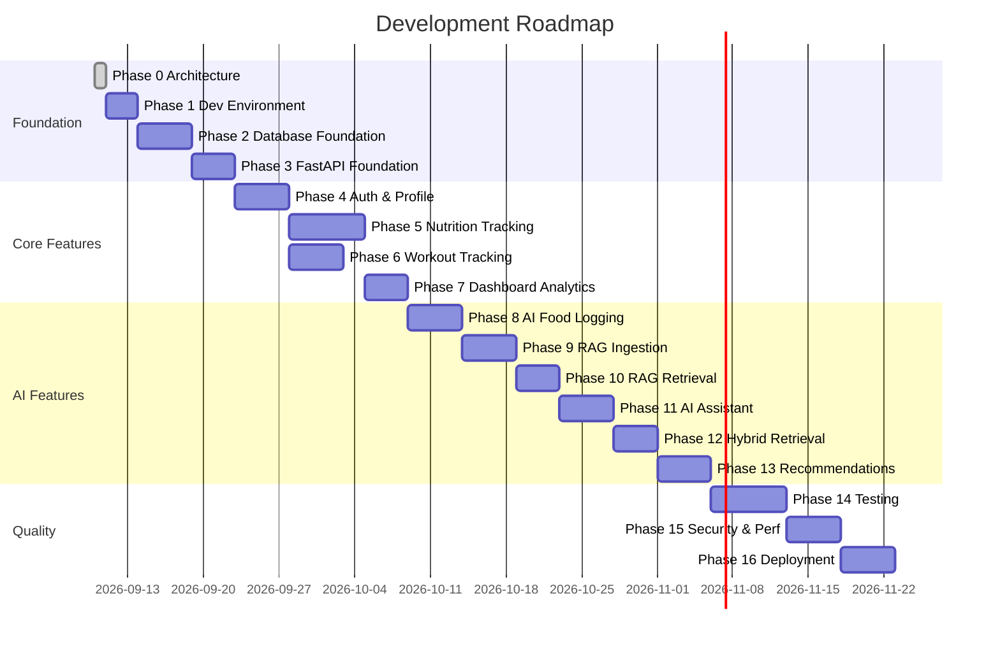

# Development Roadmap
## AI-Powered Personalized Fitness & Nutrition Assistant

**Version:** 1.1  
**Status:** Draft — Phase 0 (Corrected)  
**Date:** 2026-09-10

---

## Overview

This roadmap is sequenced by dependency. Each phase's outputs are prerequisites for the next. Phases are designed to produce working, testable software at each stage — not to defer validation to the end.

---

## Phase 0 — Architecture & Technical Specification

### Objective
Produce the complete technical blueprint guiding all subsequent implementation.

### Dependencies
None.

### Deliverables
- `docs/requirements.md`
- `docs/architecture.md`
- `docs/fastapi-architecture.md`
- `docs/database-design.md`
- `docs/api-design.md`
- `docs/ai-architecture.md`
- `docs/rag-architecture.md`
- `docs/security.md`
- `docs/testing-strategy.md`
- `docs/development-roadmap.md`
- `docs/architecture-decisions.md`

### Definition of Done
- All documents reviewed and approved
- Open questions identified
- Technology choices justified
- No implementation code created

### Out of Scope
Everything else.

---

## Phase 1 — Repository & Development Environment

### Objective
Create a working local development environment with all infrastructure running.

### Dependencies
- Phase 0 approved

### Features
- Git repository initialised with `.gitignore`, `README.md`
- Docker Compose file with:
  - PostgreSQL 16 with pgvector extension
  - pgAdmin (optional, for DB inspection)
  - Backend service (FastAPI)
  - Frontend service (React dev server)
- Python environment: pyproject.toml with Poetry or uv
- Node environment: package.json for React + TypeScript
- Environment variable template: `.env.example`
- Pre-commit hooks: ruff, mypy type checking

### Deliverables
- `docker-compose.yml`
- `backend/pyproject.toml`
- `frontend/package.json`
- `.env.example`
- `README.md` with setup instructions
- `Makefile` with common commands (up, down, test, lint)

### Definition of Done
- `docker-compose up` starts all services without errors
- FastAPI returns 200 on `GET /health`
- React dev server loads at `http://localhost:5173`
- PostgreSQL is accessible with pgvector extension loaded
- Pre-commit hooks run successfully

### Out of Scope
- Application code
- Database migrations
- Authentication

---

## Phase 2 — PostgreSQL & Database Foundation

### Objective
Set up the complete database schema with migrations and import the USDA food database.

### Dependencies
- Phase 1 (running PostgreSQL)

### Features
- SQLAlchemy async setup with connection pooling
- Alembic migration configuration
- All ORM models created (Users, Profile, Goals, Food, Nutrition, Workout, Progress, AI, RAG)
- Initial migration: creates all tables including USDA provenance columns on `food_items` and snapshot columns on `food_entries`
- pgvector extension setup in migration
- USDA FoodData Central import script (Foundation Foods + SR Legacy datasets)
  - Downloads USDA JSON bulk files
  - Normalises to per-100g values
  - Records `usda_fdc_id`, `usda_data_type`, `usda_dataset_version`
  - UPSERT into `food_items`
- Test database configuration

### Deliverables
- `backend/app/db/` — session, base, init
- `backend/app/models/` — all ORM models
- `backend/alembic/versions/001_initial_schema.py`
- `backend/alembic/versions/002_pgvector_setup.py`
- `backend/scripts/import_usda.py` — USDA FoodData Central import script
- `tests/conftest.py` — test database setup

### Definition of Done
- `alembic upgrade head` completes without errors
- All tables exist with correct columns and constraints
- Foreign key constraints are in place
- Indexes are created
- pgvector extension is loaded
- Test database is separately configured
- USDA import script runs to completion and populates `food_items` with at least 5,000 Foundation Foods / SR Legacy entries
- `usda_fdc_id` is unique per row (no duplicate imports)
- At least one food item can be found via trigram search

### Out of Scope
- API routes
- Authentication
- Business logic

---

## Phase 3 — FastAPI Foundation

### Objective
Establish the FastAPI application skeleton with all architectural layers in place.

### Dependencies
- Phase 2 (database schema)

### Features
- FastAPI app factory (`main.py`)
- Middleware: CORS, request logging, request ID injection, security headers
- API versioning structure (`/api/v1/`)
- Base repository class with CRUD operations
- Custom exception classes and global exception handler
- Pydantic settings with environment variable loading
- Structured logging with `structlog`
- Health check endpoint
- OpenAPI documentation configuration
- Lifespan events (startup/shutdown)

### Deliverables
- `backend/app/main.py`
- `backend/app/core/` — config, exceptions, middleware, security stubs
- `backend/app/api/v1/router.py`
- `backend/app/repositories/base.py`
- `GET /health` endpoint
- `GET /api/v1/docs` — working Swagger UI

### Definition of Done
- FastAPI starts without errors
- `/health` returns 200 with application info
- `/api/v1/docs` shows Swagger UI
- CORS headers present on responses
- Request IDs appear in all log lines
- 404 and 500 errors return structured JSON

### Out of Scope
- Business logic
- Authentication
- Domain routes

---

## Phase 4 — Authentication & User Profile

### Objective
Implement secure user registration, login, JWT authentication, and profile management.

### Dependencies
- Phase 3 (FastAPI foundation)
- Phase 2 (User and Profile tables)

### Features
- `POST /auth/register`
- `POST /auth/login`
- `POST /auth/refresh`
- `POST /auth/logout`
- `POST /auth/change-password`
- `GET /users/me`
- `DELETE /users/me`
- `GET /profile`, `PUT /profile`
- `GET /profile/preferences`, `PATCH /profile/preferences`
- JWT access token + refresh token (7 days)
- `get_current_user` dependency
- TDEE calculation from profile (deterministic)
- Rate limiting on auth endpoints

### Deliverables
- `backend/app/api/v1/routes/auth.py`
- `backend/app/api/v1/routes/users.py`
- `backend/app/api/v1/routes/profile.py`
- `backend/app/services/auth_service.py`
- `backend/app/services/user_service.py`
- `backend/app/services/profile_service.py`
- `backend/app/repositories/user_repository.py`
- `backend/app/utils/nutrition_calculator.py` (TDEE functions)
- `tests/unit/test_auth_service.py`
- `tests/unit/test_nutrition_calculator.py` (TDEE tests)
- `tests/e2e/test_auth_api.py`

### Definition of Done
- User can register, login, receive tokens
- Protected routes reject requests without valid token
- User cannot access another user's profile
- Access token expires after configured time
- Refresh token works
- Logout invalidates refresh token
- TDEE is calculated correctly from profile data
- Test coverage > 90% for auth service

### Out of Scope
- Email verification
- OAuth (Google, GitHub)
- 2FA

---

## Phase 5 — Nutrition Tracking

### Objective
Implement complete food logging, meal management, and daily nutrition tracking.

### Dependencies
- Phase 4 (authenticated users)
- Phase 2 (food_items seeded)

### Features
- Food search with trigram similarity
- Food item CRUD (including custom foods)
- Food entry logging (manual)
- Food entry edit and soft delete
- Daily nutrition summary (deterministic calculation)
- Daily remaining calculation
- Nutrition history (date range)
- Goals endpoints (CRUD)
- Target calculation based on active goal + TDEE

### Deliverables
- `backend/app/api/v1/routes/foods.py`
- `backend/app/api/v1/routes/nutrition.py`
- `backend/app/api/v1/routes/goals.py`
- `backend/app/services/food_service.py`
- `backend/app/services/nutrition_service.py`
- `backend/app/services/goal_service.py`
- `backend/app/repositories/food_repository.py`
- `backend/app/repositories/nutrition_repository.py`
- Frontend: Food search page, Nutrition log page, Daily summary view
- Unit tests for all calculation logic
- Integration tests for daily totals

### Definition of Done
- Food search returns results within 500ms
- Macros are calculated deterministically; no LLM involvement
- Daily totals sum correctly across all entries
- Soft-deleted entries are excluded from totals
- User isolation confirmed in tests (no cross-user data leakage)
- Goal targets influence calorie/macro targets correctly
- 100% test coverage on nutrition calculator

### Out of Scope
- AI-assisted food logging (Phase 8)
- Recommendations (Phase 13)

---

## Phase 6 — Workout Tracking

### Objective
Implement exercise database, workout session logging, and workout history.

### Dependencies
- Phase 4 (authenticated users)

### Features
- Exercise database search
- Custom exercise creation
- Workout session CRUD
- Exercise and set logging within a session
- Workout history view

### Deliverables
- `backend/app/api/v1/routes/exercises.py`
- `backend/app/api/v1/routes/workouts.py`
- `backend/app/services/workout_service.py`
- `backend/app/repositories/workout_repository.py`
- Frontend: Workout log page, Exercise browser
- Exercise seed data (100+ exercises)
- Integration tests

### Definition of Done
- Workout sessions can be created with exercises and sets
- History is retrievable in chronological order
- Soft deletion works correctly
- User isolation confirmed

### Out of Scope
- AI workout suggestions (Phase 13)
- Workout templates

---

## Phase 7 — Dashboard & Analytics

### Objective
Build the user-facing dashboard with progress charts and analytics.

### Dependencies
- Phase 5 (nutrition data)
- Phase 6 (workout data)

### Features
- `GET /progress/weight` + `POST /progress/weight`
- `GET /progress/summary`
- Dashboard: today's nutrition summary, recent workouts, goal progress, weight trend
- Progress charts (weight, calories, protein over time)
- Weekly/monthly nutrition averages

### Deliverables
- `backend/app/api/v1/routes/progress.py`
- `backend/app/services/progress_service.py`
- Frontend: Dashboard, Progress page, Charts
- Integration tests for aggregation queries

### Definition of Done
- Dashboard displays accurate data
- Charts render correctly
- Weight trend is calculated correctly
- Goal progress is visualised
- Dashboard loads in < 1 second

### Out of Scope
- AI-generated summaries (Phase 11)

---

## Phase 8 — AI Natural-Language Food Logging

### Objective
Implement LLM-powered food extraction from natural language, with DB-based resolution and user confirmation.

### Dependencies
- Phase 5 (food database)
- Phase 3 (FastAPI foundation)

### Features
- LLM provider abstraction layer
- `text-embedding-3-small` embedding abstraction
- Food extraction prompt + structured output parser
- `POST /nutrition/log-natural-language`
- `POST /nutrition/log-natural-language/confirm`
- User confirmation step before committing entries
- Token usage logging

### Deliverables
- `backend/app/ai/providers/` — base + OpenAI
- `backend/app/ai/prompts/food_extraction.py`
- `backend/app/ai/parsers/food_extraction_parser.py`
- Frontend: AI food logging interface, confirmation UI
- Unit tests for parser (all edge cases)
- Mock LLM for integration tests

### Definition of Done
- LLM extracts food items and quantities from natural language
- Backend resolves extractions to DB food items (not LLM values)
- Macros are always calculated from the DB record
- User must confirm before entries are logged
- Unresolvable items are clearly indicated
- LLM failure does not crash the app

### Out of Scope
- RAG (Phase 9)
- General AI assistant (Phase 11)

---

## Phase 9 — RAG Ingestion Pipeline

### Objective
Build the knowledge base ingestion pipeline: load, clean, chunk, embed, and store documents.

### Dependencies
- Phase 2 (knowledge_documents + document_chunks tables)
- Phase 8 (embedding abstraction)

### Features
- Document loader (Markdown, text, PDF)
- Cleaner and normaliser
- Recursive text chunker (512 tokens, 64 overlap)
- Metadata extractor (title, section, topic)
- Batch embedding generation
- pgvector storage
- Admin API for document management
- Ingestion status tracking
- `scripts/ingest_knowledge_base.py`
- Initial knowledge base: 20–50 fitness/nutrition documents

### Deliverables
- `backend/app/rag/ingestion/`
- `backend/app/rag/embedding/`
- `backend/app/rag/pipeline.py`
- `backend/app/api/v1/routes/rag.py` (admin)
- `backend/scripts/ingest_knowledge_base.py`
- `knowledge-base/` directory with curated documents
- Integration tests for chunking and storage

### Definition of Done
- Documents are chunked and stored correctly
- Embeddings are generated and stored in pgvector
- HNSW index is created on the embedding column
- Re-ingestion correctly replaces old chunks
- Ingestion status is trackable
- At least 20 documents ingested

### Out of Scope
- Retrieval (Phase 10)
- LLM generation (Phase 11)

---

## Phase 10 — RAG Retrieval

### Objective
Implement vector similarity retrieval and build the retrieval-to-context pipeline.

### Dependencies
- Phase 9 (populated knowledge base)

### Features
- `retrieve()` function with pgvector cosine search
- Metadata filtering by `topic_category`
- Minimum similarity threshold
- Retrieved chunk formatting for LLM context
- Citation tracking schema
- RAG evaluation script with golden test set
- Debug endpoint: `POST /rag/search`

### Deliverables
- `backend/app/rag/retrieval/retriever.py`
- `backend/app/rag/context/context_builder.py`
- `backend/app/repositories/knowledge_repository.py`
- `backend/scripts/evaluate_rag.py`
- Integration tests for retrieval

### Definition of Done
- Retrieval returns relevant chunks for in-domain queries
- Metadata filtering works correctly
- Retrieval latency < 200ms p95
- Low-similarity results are filtered
- RAG evaluation script produces Precision@5 > 0.70

### Out of Scope
- Cross-encoder reranking (optional later)
- LLM generation

---

## Phase 11 — AI Assistant

### Objective
Build the general AI assistant with hybrid context (user data + RAG).

### Dependencies
- Phase 10 (RAG retrieval)
- Phase 7 (dashboard data for user context)

### Features
- `POST /ai/chat`
- Conversation management (create, list, retrieve, delete)
- AI context builder (profile + nutrition + workout + RAG + history)
- Token budget manager
- System prompt with safety boundaries
- Citation tracking in responses
- `POST /ai/summarise-today`
- Conversation history injection
- Response streaming (optional)
- Rate limiting on AI endpoints

### Deliverables
- `backend/app/ai/orchestrator.py`
- `backend/app/ai/context/builder.py`
- `backend/app/ai/context/token_budget.py`
- `backend/app/ai/prompts/assistant.py`
- `backend/app/api/v1/routes/ai.py`
- Frontend: AI chat interface with message history, source citations
- Unit tests for context builder, prompt tests
- Integration tests with mock LLM

### Definition of Done
- AI responds to fitness/nutrition questions
- Responses are grounded in retrieved knowledge
- User data is not invented (test with assertion checks)
- Citations are displayed in the UI
- Safety boundaries are present in system prompt
- Conversation history is maintained
- AI failure returns 503 gracefully

### Out of Scope
- Workout and meal recommendations (Phase 13)

---

## Phase 12 — Hybrid Personal + RAG Reasoning

### Objective
Combine user-specific structured data with RAG knowledge in a principled context assembly pipeline.

### Dependencies
- Phase 11 (AI assistant)

### Features
- Multi-source context assembly service
- Intelligent query routing (which data to fetch based on query type)
- Context prioritisation and trimming when token budget is tight
- Proof of correctness: AI references user's own data accurately
- `user_data_used` field in responses (transparency)

### Deliverables
- `backend/app/services/ai_context_service.py`
- Enhanced orchestrator with multi-source context
- Tests proving user data is accurately referenced
- Tests proving AI does not invent user data
- Documentation of context assembly strategy

### Definition of Done
- AI correctly references user's weight, calorie intake, workout history
- AI does not fabricate numbers when asked specific questions about user history
- Context assembly is within token budget for typical queries
- `user_data_used` field indicates which personal data sources were included

### Out of Scope
- Recommendation engine (Phase 13)

---

## Phase 13 — Personalized Recommendations

### Objective
Implement deterministic filtering + AI explanation for meal and workout recommendations.

### Dependencies
- Phase 12 (hybrid context)
- Phase 5 (food/nutrition data)
- Phase 6 (workout data)

### Features
- `GET /recommendations/meals`
- `GET /recommendations/workouts`
- Deterministic meal filtering (calorie/macro constraints)
- Deterministic workout planning (recovery logic)
- AI explanation generation for pre-filtered candidates
- Dietary restriction filtering

### Deliverables
- `backend/app/services/recommendation_service.py`
- `backend/app/ai/prompts/recommendations.py`
- `backend/app/api/v1/routes/recommendations.py`
- Frontend: Recommendation cards on dashboard
- Unit tests for deterministic filtering
- Integration tests for full recommendation flow

### Definition of Done
- Meal suggestions fit within remaining calorie/macro budget
- Dietary restrictions are respected
- Workout suggestions respect muscle group recovery rules
- AI explanations reference the user's actual context
- Recommendations are useful (manual review of 10 sample outputs)

### Out of Scope
- Weekly meal plans
- Workout template library

---

## Phase 14 — Testing & Evaluation

### Objective
Reach coverage targets, build the RAG evaluation suite, and address gaps.

### Dependencies
- Phase 13 (all features implemented)

### Features
- Achieve coverage targets (80%+ overall, 100% on calculators)
- Complete RAG evaluation dataset (50+ golden questions)
- AI safety boundary testing
- Hallucination detection tests
- Load testing (basic)
- Playwright E2E tests for critical journeys

### Deliverables
- Coverage report
- RAG evaluation results
- E2E test suite
- Performance baseline measurements
- Bug fixes identified through testing

### Definition of Done
- Unit + integration coverage ≥ 80%
- Nutrition calculator coverage = 100%
- RAG Precision@5 ≥ 0.70
- All critical user journeys covered by E2E tests
- No P0/P1 bugs outstanding

### Out of Scope
- New features

---

## Phase 15 — Security & Optimisation

### Objective
Harden security, optimise performance, and address technical debt.

### Dependencies
- Phase 14 (stable feature set)

### Features
- Security review against checklist
- Rate limiting audit
- Input validation review
- Prompt injection testing
- Database query optimisation (EXPLAIN ANALYZE on slow queries)
- API response time optimisation
- Token cost analysis and optimisation
- Frontend bundle optimisation

### Deliverables
- Security review report
- Performance profiling results
- Optimised slow queries
- Updated rate limiting configuration
- Frontend lighthouse scores

### Definition of Done
- Security checklist complete
- Food search < 500ms p95
- Dashboard load < 1s p95
- AI first token < 2s p95
- No critical security findings unaddressed

---

## Phase 16 — Deployment

### Objective
Deploy the application to a cloud provider and configure CI/CD.

### Dependencies
- Phase 15 (hardened, optimised)

### Features
- Choose deployment target (Railway, Render, Fly.io recommended for portfolio)
- Dockerfile for backend
- Frontend static build + CDN (Vercel, Netlify, or same platform)
- PostgreSQL managed instance with pgvector support
- Environment variables configured in platform
- GitHub Actions CI/CD:
  - Run lint + tests on every PR
  - Deploy to production on merge to main
- Domain + HTTPS configuration
- Basic monitoring (uptime, error rates)

### Deliverables
- `backend/Dockerfile`
- `frontend/Dockerfile` (or static build config)
- `.github/workflows/ci.yml`
- `.github/workflows/deploy.yml`
- Live URL documented in README

### Definition of Done
- Application is accessible at a public URL
- CI pipeline runs on every PR
- Deployment is automated on merge
- HTTPS is enabled
- README includes live URL and setup instructions

---

## MVP Scope

### MVP (Phases 1–7 + Phase 8)

The minimum valuable product works without advanced RAG:

**Included:**
- User registration and login
- Fitness profile and goal setting
- Food database search and manual food logging
- AI natural-language food logging (Phase 8)
- Daily nutrition tracking and calorie/macro targets
- Workout logging
- Body weight tracking
- Dashboard with charts and progress
- Deterministic recommendations (remaining macros displayed)

**Not Included in MVP:**
- RAG knowledge base
- AI assistant with grounded responses
- Hybrid personal + RAG context
- AI meal and workout recommendations

### Version 2 (MVP + Phases 9–13)

Adds:
- RAG knowledge base
- AI assistant with citations
- Personalized AI meal and workout recommendations
- Hybrid personal + knowledge retrieval

### Advanced Version (V2 + Phases 14–16)

Adds:
- Full test coverage and RAG evaluation
- Security hardening
- Production deployment
- CI/CD pipeline
- Performance optimisation

---

## Risk Log

| Risk | Phase | Likelihood | Impact | Mitigation |
|------|-------|-----------|--------|------------|
| Food database sourcing (licensing) | Phase 2 | Medium | High | Identify source before starting Phase 2 |
| LLM API costs | Phase 8+ | Medium | Medium | Rate limiting; mock in tests; use mini models |
| pgvector performance at scale | Phase 9 | Low | Medium | HNSW index; evaluate if needed |
| Prompt injection in production | Phase 8+ | Low | High | Security review in Phase 15 |
| Scope creep | Any | High | High | Strict phase boundaries; MVP-first mindset |
