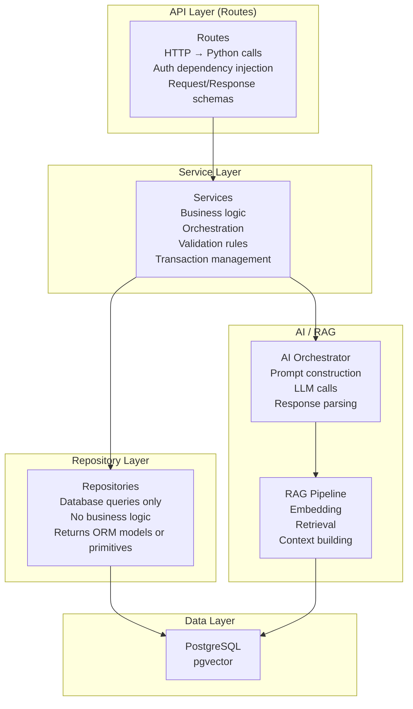

# FastAPI Backend Architecture
## AI-Powered Personalized Fitness & Nutrition Assistant

**Version:** 1.1  
**Status:** Draft — Phase 0 (Corrected)  
**Date:** 2026-09-10

---

## Table of Contents

1. [Directory Structure](#directory-structure)
2. [Layer Responsibilities](#layer-responsibilities)
3. [API Layer](#api-layer)
4. [Service Layer](#service-layer)
5. [Repository Layer](#repository-layer)
6. [Domain Models](#domain-models)
7. [Schemas (Pydantic)](#schemas-pydantic)
8. [AI Orchestration Layer](#ai-orchestration-layer)
9. [RAG Layer](#rag-layer)
10. [Configuration](#configuration)
11. [Dependency Injection](#dependency-injection)
12. [Validation](#validation)
13. [Error Handling](#error-handling)
14. [Logging](#logging)
15. [Module Layout Example](#module-layout-example)

---

## 1. Directory Structure

```
backend/
│
├── app/
│   ├── __init__.py
│   ├── main.py                    # FastAPI app factory, lifespan, middleware
│   │
│   ├── api/
│   │   ├── __init__.py
│   │   ├── v1/
│   │   │   ├── __init__.py
│   │   │   ├── router.py          # Aggregates all v1 routes
│   │   │   └── routes/
│   │   │       ├── auth.py
│   │   │       ├── users.py
│   │   │       ├── profile.py
│   │   │       ├── goals.py
│   │   │       ├── foods.py
│   │   │       ├── meals.py
│   │   │       ├── nutrition.py
│   │   │       ├── exercises.py
│   │   │       ├── workouts.py
│   │   │       ├── progress.py
│   │   │       ├── ai.py
│   │   │       ├── rag.py
│   │   │       └── recommendations.py
│   │   │
│   │   └── dependencies/
│   │       ├── __init__.py
│   │       ├── auth.py            # get_current_user, require_active_user
│   │       ├── database.py        # get_db (async session)
│   │       ├── pagination.py      # Common pagination params
│   │       └── rate_limiting.py   # Rate limiter dependencies
│   │
│   ├── core/
│   │   ├── __init__.py
│   │   ├── config.py              # Pydantic Settings (env-driven)
│   │   ├── security.py            # JWT, password hashing utilities
│   │   ├── exceptions.py          # Custom exception classes
│   │   ├── middleware.py          # Request ID, CORS, logging middleware
│   │   ├── events.py              # Startup/shutdown lifespan events
│   │   └── constants.py           # App-wide constants (meal types, etc.)
│   │
│   ├── db/
│   │   ├── __init__.py
│   │   ├── base.py                # SQLAlchemy declarative base
│   │   ├── session.py             # Async engine + session factory
│   │   └── init_db.py             # DB initialisation utilities
│   │
│   ├── models/                    # SQLAlchemy ORM models (one file per domain)
│   │   ├── __init__.py
│   │   ├── user.py
│   │   ├── profile.py
│   │   ├── goal.py
│   │   ├── food.py
│   │   ├── nutrition.py
│   │   ├── workout.py
│   │   ├── progress.py
│   │   ├── ai_conversation.py
│   │   └── knowledge.py
│   │
│   ├── schemas/                   # Pydantic request/response schemas
│   │   ├── __init__.py
│   │   ├── auth.py
│   │   ├── user.py
│   │   ├── profile.py
│   │   ├── goal.py
│   │   ├── food.py
│   │   ├── nutrition.py
│   │   ├── workout.py
│   │   ├── progress.py
│   │   ├── ai.py
│   │   ├── rag.py
│   │   └── recommendations.py
│   │
│   ├── repositories/              # Data access layer (one per aggregate)
│   │   ├── __init__.py
│   │   ├── base.py                # Generic CRUD repository
│   │   ├── user_repository.py
│   │   ├── profile_repository.py
│   │   ├── goal_repository.py
│   │   ├── food_repository.py
│   │   ├── nutrition_repository.py
│   │   ├── workout_repository.py
│   │   ├── progress_repository.py
│   │   ├── conversation_repository.py
│   │   └── knowledge_repository.py
│   │
│   ├── services/                  # Business logic layer
│   │   ├── __init__.py
│   │   ├── auth_service.py
│   │   ├── user_service.py
│   │   ├── profile_service.py
│   │   ├── goal_service.py
│   │   ├── food_service.py
│   │   ├── nutrition_service.py
│   │   ├── workout_service.py
│   │   ├── progress_service.py
│   │   └── recommendation_service.py
│   │
│   ├── ai/
│   │   ├── __init__.py
│   │   ├── orchestrator.py        # Main AI service / entry point
│   │   ├── providers/
│   │   │   ├── __init__.py
│   │   │   ├── base.py            # Abstract LLM provider interface
│   │   │   ├── openai_provider.py
│   │   │   └── anthropic_provider.py  # (future)
│   │   ├── prompts/
│   │   │   ├── __init__.py
│   │   │   ├── system_prompts.py
│   │   │   ├── food_extraction.py
│   │   │   ├── nutrition_summary.py
│   │   │   ├── recommendations.py
│   │   │   └── assistant.py
│   │   ├── context/
│   │   │   ├── __init__.py
│   │   │   ├── builder.py         # Assembles user context for prompts
│   │   │   └── token_budget.py    # Token budget management
│   │   └── parsers/
│   │       ├── __init__.py
│   │       └── food_extraction_parser.py
│   │
│   ├── rag/
│   │   ├── __init__.py
│   │   ├── pipeline.py            # RAG orchestration
│   │   ├── ingestion/
│   │   │   ├── __init__.py
│   │   │   ├── document_loader.py
│   │   │   ├── cleaner.py
│   │   │   ├── chunker.py
│   │   │   └── metadata_extractor.py
│   │   ├── embedding/
│   │   │   ├── __init__.py
│   │   │   ├── base.py            # Abstract embedding interface
│   │   │   └── openai_embedder.py
│   │   ├── retrieval/
│   │   │   ├── __init__.py
│   │   │   ├── retriever.py       # Vector similarity search
│   │   │   └── reranker.py        # Optional reranking
│   │   └── context/
│   │       ├── __init__.py
│   │       └── context_builder.py # Formats retrieved chunks for LLM
│   │
│   └── utils/
│       ├── __init__.py
│       ├── nutrition_calculator.py  # Deterministic macro/calorie calculations
│       ├── date_utils.py
│       ├── text_utils.py
│       └── validators.py
│
├── tests/
│   ├── __init__.py
│   ├── conftest.py
│   ├── unit/
│   ├── integration/
│   └── e2e/
│
├── alembic/
│   ├── env.py
│   ├── versions/
│   └── alembic.ini
│
├── scripts/
│   ├── seed_food_database.py
│   ├── ingest_knowledge_base.py
│   └── create_admin.py
│
├── pyproject.toml                 # Dependencies (Poetry or uv)
├── Dockerfile
└── .env.example
```

---

## 2. Layer Responsibilities



**Key Rules:**
- Routes never call repositories directly
- Repositories never contain business logic
- Services never construct SQL strings
- AI module never queries the database
- Schemas (Pydantic) are never ORM models

---

## 3. API Layer

### 3.1 Design Principles

- Routes are thin: validate input, call service, return response
- Dependency injection for authentication, DB session, pagination
- Versioned under `/api/v1/`
- All responses use Pydantic response models (no ORM objects returned directly)
- HTTP status codes follow REST conventions strictly

### 3.2 Route Pattern

```python
# Example: Correct route pattern
@router.post(
    "/entries",
    response_model=FoodEntryResponse,
    status_code=status.HTTP_201_CREATED,
    summary="Log a food entry",
)
async def log_food_entry(
    entry_data: FoodEntryCreate,                     # Validated request body
    db: AsyncSession = Depends(get_db),              # DB session
    current_user: User = Depends(get_current_user),  # Auth
    nutrition_service: NutritionService = Depends(get_nutrition_service),
) -> FoodEntryResponse:
    entry = await nutrition_service.log_food_entry(
        user_id=current_user.id,
        entry_data=entry_data,
        db=db,
    )
    return FoodEntryResponse.model_validate(entry)
```

### 3.3 API Versioning

All routes are prefixed `/api/v1/`. Future breaking changes introduce `/api/v2/` without removing `v1` immediately.

### 3.4 OpenAPI Documentation

FastAPI auto-generates `/docs` (Swagger UI) and `/redoc`. All routes include:
- `summary`
- `description`
- `response_model`
- `responses` (error cases)
- `tags`

---

## 4. Service Layer

### 4.1 Responsibilities

- Business logic: calorie target calculation, goal progress evaluation
- Orchestrating multiple repositories in a single transaction
- Calling AI module when AI features are requested
- Enforcing business rules (e.g., a user can only have one active goal per type)
- Raising domain exceptions

### 4.2 Service Pattern

```python
class NutritionService:
    def __init__(
        self,
        food_repo: FoodRepository,
        nutrition_repo: NutritionRepository,
        goal_repo: GoalRepository,
    ) -> None:
        self.food_repo = food_repo
        self.nutrition_repo = nutrition_repo
        self.goal_repo = goal_repo

    async def log_food_entry(
        self,
        user_id: UUID,
        entry_data: FoodEntryCreate,
        db: AsyncSession,
    ) -> FoodEntry:
        food_item = await self.food_repo.get_by_id(db, entry_data.food_item_id)
        if not food_item:
            raise FoodItemNotFoundError(entry_data.food_item_id)

        # Deterministic calculation — never delegated to LLM
        macros = calculate_macros(food_item, entry_data.quantity, entry_data.unit)

        return await self.nutrition_repo.create_entry(
            db,
            user_id=user_id,
            food_item_id=food_item.id,
            macros=macros,
            meal_type=entry_data.meal_type,
            logged_at=entry_data.logged_at,
        )
```

### 4.3 Transaction Management

Services manage transaction boundaries. Repositories do not open transactions independently.

```python
async with db.begin():
    entry = await self.nutrition_repo.create_entry(db, ...)
    await self.nutrition_repo.update_daily_totals(db, ...)
```

---

## 5. Repository Layer

### 5.1 Responsibilities

- Execute database queries using SQLAlchemy async
- Map ORM models to/from the service layer
- No business logic; no calculations; no external calls

### 5.2 Base Repository Pattern

```python
class BaseRepository(Generic[ModelType]):
    def __init__(self, model: type[ModelType]) -> None:
        self.model = model

    async def get_by_id(self, db: AsyncSession, id: UUID) -> ModelType | None:
        result = await db.execute(select(self.model).where(self.model.id == id))
        return result.scalar_one_or_none()

    async def create(self, db: AsyncSession, **kwargs) -> ModelType:
        instance = self.model(**kwargs)
        db.add(instance)
        await db.flush()
        return instance

    async def delete(self, db: AsyncSession, instance: ModelType) -> None:
        await db.delete(instance)
```

---

## 6. Domain Models

### 6.1 SQLAlchemy ORM Models

Located in `app/models/`. Each file contains the ORM models for one domain.

```python
# Example: Base model mixin
class TimestampMixin:
    created_at: Mapped[datetime] = mapped_column(
        DateTime(timezone=True), server_default=func.now(), nullable=False
    )
    updated_at: Mapped[datetime] = mapped_column(
        DateTime(timezone=True), server_default=func.now(), onupdate=func.now(), nullable=False
    )

class SoftDeleteMixin:
    deleted_at: Mapped[datetime | None] = mapped_column(DateTime(timezone=True), nullable=True)

    @property
    def is_deleted(self) -> bool:
        return self.deleted_at is not None
```

### 6.2 Model ↔ Schema Separation

ORM models (SQLAlchemy) are **never** returned directly from API routes. They are always converted to Pydantic schemas at the service or route boundary.

---

## 7. Schemas (Pydantic)

### 7.1 Schema Naming Convention

| Type | Naming | Purpose |
|------|--------|---------|
| `FoodEntryCreate` | `{Entity}Create` | POST request body |
| `FoodEntryUpdate` | `{Entity}Update` | PUT/PATCH body |
| `FoodEntryResponse` | `{Entity}Response` | API response |
| `FoodEntryInDB` | `{Entity}InDB` | Internal DB representation |
| `FoodEntryFilter` | `{Entity}Filter` | Query parameters |

### 7.2 Example Schema

```python
class FoodEntryCreate(BaseModel):
    food_item_id: UUID
    quantity: Annotated[float, Field(gt=0, le=10000)]
    unit: ServingUnit
    meal_type: MealType
    logged_at: datetime | None = None

    @field_validator("quantity")
    @classmethod
    def validate_quantity(cls, v: float) -> float:
        if v <= 0:
            raise ValueError("Quantity must be positive")
        return round(v, 3)


class FoodEntryResponse(BaseModel):
    id: UUID
    food_item_id: UUID
    food_item_name: str
    quantity: float
    unit: ServingUnit
    meal_type: MealType
    calories: float
    protein_g: float
    carbohydrates_g: float
    fat_g: float
    logged_at: datetime
    created_at: datetime

    model_config = ConfigDict(from_attributes=True)
```

---

## 8. AI Orchestration Layer

### 8.1 Structure

```
app/ai/
├── orchestrator.py        # Public interface: chat(), extract_food_items(), etc.
├── providers/
│   ├── base.py            # AbstractLLMProvider (interface)
│   └── openai_provider.py # Concrete implementation
├── prompts/               # Version-controlled prompt templates
├── context/
│   ├── builder.py         # Assembles UserContext for injection into prompts
│   └── token_budget.py    # Manages context window limits
└── parsers/               # Parse structured LLM outputs
```

### 8.2 Provider Abstraction

```python
class AbstractLLMProvider(ABC):
    @abstractmethod
    async def complete(
        self,
        messages: list[Message],
        response_format: ResponseFormat | None = None,
        tools: list[Tool] | None = None,
        temperature: float = 0.7,
        max_tokens: int = 1000,
    ) -> LLMResponse:
        ...

    @abstractmethod
    async def embed(self, text: str) -> list[float]:
        ...
```

### 8.3 Prompt Management

Prompts are version-controlled Python modules, not strings scattered in application code. Each prompt module exports a builder function:

```python
# app/ai/prompts/food_extraction.py
FOOD_EXTRACTION_SYSTEM = """
You are a nutrition assistant. Extract all food items and quantities from the user's message.
Return a JSON array of objects with: food_name, quantity, unit.
Do NOT invent nutritional data. Only identify what the user mentioned.
If you cannot confidently identify a food item, set "confidence": "low".
"""

def build_food_extraction_prompt(user_message: str) -> list[Message]:
    return [
        Message(role="system", content=FOOD_EXTRACTION_SYSTEM),
        Message(role="user", content=user_message),
    ]
```

### 8.4 Context Budget Management

```python
class TokenBudgetManager:
    MAX_CONTEXT_TOKENS = 6000  # Reserve room for response

    def build_context(
        self,
        user_profile: UserContext,
        nutrition_summary: NutritionSummary | None,
        rag_chunks: list[RetrievedChunk],
        conversation_history: list[ConversationMessage],
    ) -> str:
        # Priority order: profile > today's data > RAG > history
        # Truncate least-priority items if over budget
        ...
```

---

## 9. RAG Layer

### 9.1 Structure

```
app/rag/
├── pipeline.py            # Ingestion + retrieval orchestration
├── ingestion/
│   ├── document_loader.py # Load PDF, Markdown, plain text
│   ├── cleaner.py         # Remove noise, normalise whitespace
│   ├── chunker.py         # Recursive text splitting
│   └── metadata_extractor.py
├── embedding/
│   ├── base.py            # AbstractEmbedder
│   └── openai_embedder.py
├── retrieval/
│   ├── retriever.py       # pgvector similarity search
│   └── reranker.py        # Cross-encoder reranking (optional)
└── context/
    └── context_builder.py # Format retrieved chunks for LLM
```

### 9.2 Ingestion Pipeline

```
Document → Load → Clean → Chunk → Extract Metadata → Embed → Store in pgvector
```

Ingestion runs as a **background task** triggered by admin API or script. It never blocks the request-handling path.

### 9.3 Retrieval Pattern

```python
async def retrieve(
    query: str,
    top_k: int = 5,
    filters: dict | None = None,
    min_similarity: float = 0.7,
) -> list[RetrievedChunk]:
    query_embedding = await embedder.embed(query)
    chunks = await knowledge_repo.similarity_search(
        embedding=query_embedding,
        top_k=top_k,
        filters=filters,
        min_similarity=min_similarity,
    )
    return chunks
```

---

## 10. Configuration

### 10.1 Pydantic Settings

```python
# app/core/config.py
class Settings(BaseSettings):
    # App
    APP_NAME: str = "Fitness AI"
    DEBUG: bool = False
    ENVIRONMENT: Literal["development", "staging", "production"] = "development"

    # Database
    DATABASE_URL: PostgresDsn
    DB_POOL_SIZE: int = 10
    DB_MAX_OVERFLOW: int = 20

    # Auth
    SECRET_KEY: str  # Required, no default
    ACCESS_TOKEN_EXPIRE_MINUTES: int = 30
    REFRESH_TOKEN_EXPIRE_DAYS: int = 7
    ALGORITHM: str = "HS256"

    # AI
    OPENAI_API_KEY: str
    OPENAI_MODEL: str = "gpt-4o-mini"
    EMBEDDING_MODEL: str = "text-embedding-3-small"

    # RAG
    RAG_CHUNK_SIZE: int = 512
    RAG_CHUNK_OVERLAP: int = 64
    RAG_TOP_K: int = 5

    # Rate Limiting
    AI_RATE_LIMIT_PER_MINUTE: int = 20

    model_config = SettingsConfigDict(env_file=".env", case_sensitive=True)


settings = Settings()
```

---

## 11. Dependency Injection

FastAPI's native dependency injection is used throughout. Services are instantiated once per request via dependencies.

```python
# app/api/dependencies/services.py
def get_nutrition_service(
    db: AsyncSession = Depends(get_db),
) -> NutritionService:
    food_repo = FoodRepository()
    nutrition_repo = NutritionRepository()
    goal_repo = GoalRepository()
    return NutritionService(food_repo, nutrition_repo, goal_repo)
```

**Note:** For services that are expensive to initialise (LLM providers), use application-level lifespan singletons, not per-request instantiation.

```python
# app/core/events.py — lifespan
@asynccontextmanager
async def lifespan(app: FastAPI):
    # Startup
    llm_provider = OpenAIProvider(api_key=settings.OPENAI_API_KEY)
    app.state.llm_provider = llm_provider
    app.state.embedder = OpenAIEmbedder(api_key=settings.OPENAI_API_KEY)
    yield
    # Shutdown: cleanup connections
```

---

## 12. Validation

### 12.1 Input Validation

Pydantic validates all request bodies automatically. Custom validators enforce domain rules.

```python
class GoalCreate(BaseModel):
    goal_type: GoalType
    target_value: Annotated[float, Field(gt=0)]
    target_date: date

    @model_validator(mode="after")
    def validate_target_date(self) -> "GoalCreate":
        if self.target_date <= date.today():
            raise ValueError("Target date must be in the future")
        return self
```

### 12.2 Query Parameter Validation

```python
class PaginationParams:
    def __init__(
        self,
        page: Annotated[int, Query(ge=1)] = 1,
        size: Annotated[int, Query(ge=1, le=100)] = 20,
    ) -> None:
        self.page = page
        self.size = size
        self.offset = (page - 1) * size
```

---

## 13. Error Handling

### 13.1 Custom Exception Hierarchy

```python
# app/core/exceptions.py
class AppException(Exception):
    def __init__(self, message: str, status_code: int = 500) -> None:
        self.message = message
        self.status_code = status_code

class NotFoundError(AppException):
    def __init__(self, resource: str, id: Any) -> None:
        super().__init__(f"{resource} with id {id} not found", status_code=404)

class AuthorizationError(AppException):
    def __init__(self) -> None:
        super().__init__("Not authorized to access this resource", status_code=403)

class ValidationError(AppException):
    def __init__(self, message: str) -> None:
        super().__init__(message, status_code=422)

class AIServiceError(AppException):
    def __init__(self, message: str) -> None:
        super().__init__(message, status_code=503)
```

### 13.2 Global Exception Handler

```python
# app/main.py
@app.exception_handler(AppException)
async def app_exception_handler(request: Request, exc: AppException) -> JSONResponse:
    return JSONResponse(
        status_code=exc.status_code,
        content={
            "error": exc.message,
            "request_id": request.state.request_id,
        },
    )
```

### 13.3 Error Response Schema

```json
{
  "error": "Food item with id abc-123 not found",
  "request_id": "req-abc-xyz-123",
  "details": {}
}
```

---

## 14. Logging

### 14.1 Structured Logging

Use `structlog` for structured JSON logging in production.

```python
import structlog

logger = structlog.get_logger(__name__)

# In a service
logger.info(
    "food_entry_logged",
    user_id=str(user_id),
    food_item_id=str(food_item_id),
    calories=macros.calories,
    meal_type=meal_type.value,
)
```

### 14.2 Request Logging Middleware

```python
class RequestLoggingMiddleware(BaseHTTPMiddleware):
    async def dispatch(self, request: Request, call_next):
        request_id = str(uuid4())
        request.state.request_id = request_id
        start = time.perf_counter()

        logger.info(
            "request_started",
            request_id=request_id,
            method=request.method,
            path=request.url.path,
        )

        response = await call_next(request)
        elapsed = time.perf_counter() - start

        logger.info(
            "request_completed",
            request_id=request_id,
            status_code=response.status_code,
            elapsed_ms=round(elapsed * 1000, 2),
        )
        response.headers["X-Request-ID"] = request_id
        return response
```

### 14.3 AI Request Logging

```python
logger.info(
    "llm_request",
    request_id=request_id,
    model=model_name,
    prompt_tokens=usage.prompt_tokens,
    completion_tokens=usage.completion_tokens,
    total_tokens=usage.total_tokens,
    latency_ms=latency,
    feature="food_extraction",  # Which feature triggered this
)
```

**Important:** Never log raw user messages, LLM responses, or PII in production logs.

---

## 15. Module Layout Example

### Complete Flow: Nutrition Daily Summary

```
GET /api/v1/nutrition/daily?date=2026-09-10
    │
    ▼
routes/nutrition.py
    ├── Validates query params
    ├── Injects current_user, db, nutrition_service
    └── Calls nutrition_service.get_daily_summary(user_id, date)
            │
            ▼
    services/nutrition_service.py
        ├── nutrition_repo.get_entries_for_date(user_id, date)
        ├── goal_repo.get_active_goal(user_id)
        ├── Calculate daily totals (deterministic)
        ├── Calculate target delta (deterministic)
        └── Returns DailySummaryResult
                │
                ▼
    repositories/nutrition_repository.py
        └── SELECT food_entries WHERE user_id AND log_date (uses pre-calculated snapshot columns; see ADR-012 & ADR-015)
                │
                ▼
    PostgreSQL
```

No AI is involved in this flow — it's pure deterministic computation using frozen historical snapshot columns (`calories_snapshot`, `protein_g_snapshot`, `carbs_g_snapshot`, `fat_g_snapshot`). `food_item_id` is retained only for display/navigation, ensuring historical calculations never change if the underlying `food_items` record is updated. This is the correct design.
