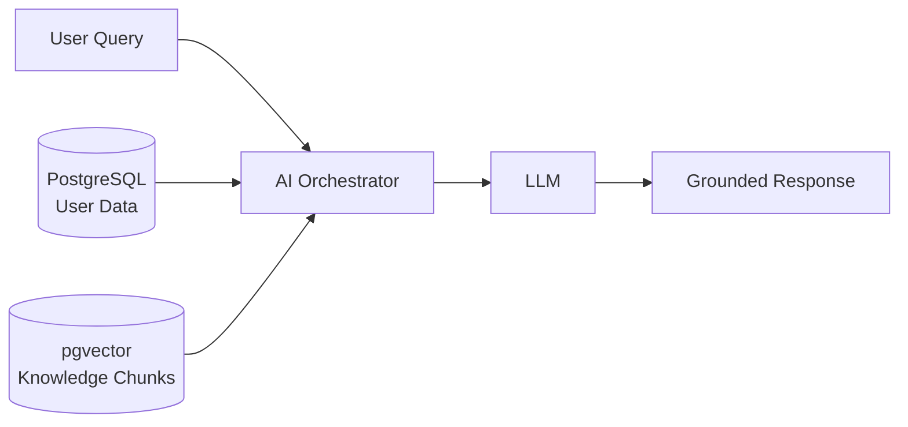
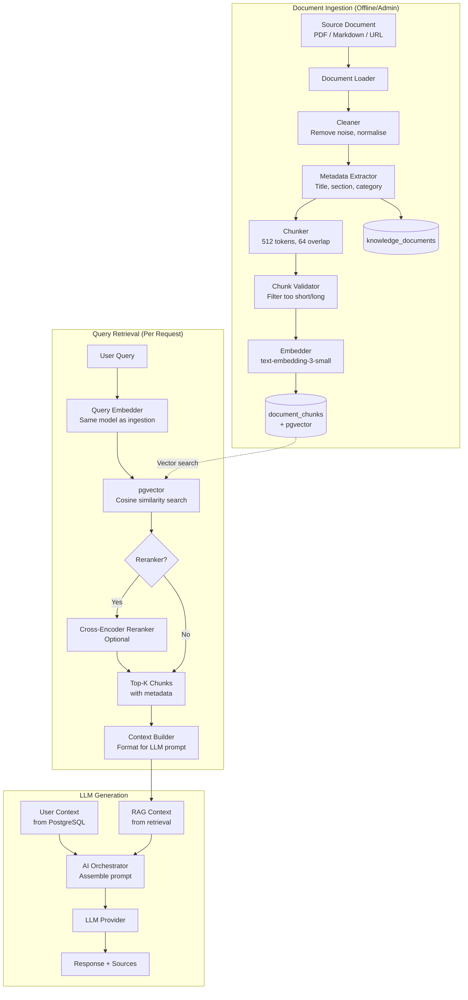

# RAG Architecture
## AI-Powered Personalized Fitness & Nutrition Assistant

**Version:** 1.1  
**Status:** Draft — Phase 0 (Corrected)  
**Date:** 2026-09-10

---

## Table of Contents

1. [RAG Overview](#rag-overview)
2. [Knowledge Base Design](#knowledge-base-design)
3. [Document Ingestion Pipeline](#document-ingestion-pipeline)
4. [Chunking Strategy](#chunking-strategy)
5. [Embedding Strategy](#embedding-strategy)
6. [Vector Storage (pgvector)](#vector-storage-pgvector)
7. [Retrieval Pipeline](#retrieval-pipeline)
8. [Metadata Filtering](#metadata-filtering)
9. [Reranking Strategy](#reranking-strategy)
10. [Context Construction for LLM](#context-construction-for-llm)
11. [Citation and Source Tracking](#citation-and-source-tracking)
12. [Document Versioning and Updates](#document-versioning-and-updates)
13. [Handling Outdated Documents](#handling-outdated-documents)
14. [RAG Quality Evaluation](#rag-quality-evaluation)
15. [RAG Pipeline Diagram](#rag-pipeline-diagram)

---

## 1. RAG Overview

### What RAG Solves

The LLM has broad training knowledge but:
- May contain outdated or incorrect information
- Does not know the user's specific context
- Cannot cite sources reliably
- May hallucinate specific facts (protein requirements, training frequencies, etc.)

RAG grounds the LLM's responses in a **curated, trusted knowledge base** — documents you control, can update, and can attribute.

### What RAG Does NOT Solve

RAG does not replace:
- Deterministic calculations (macro arithmetic)
- Structured data retrieval (SQL queries for user history)
- Medical expertise

### Architecture Position



RAG provides the knowledge base component. The AI orchestrator combines it with user data.

---

## 2. Knowledge Base Design

### 2.1 Document Sources

| Category | Source Type | Examples |
|----------|-------------|---------|
| Nutrition science | Curated PDFs / Markdown | USDA dietary guidelines, macronutrient research summaries |
| Exercise science | Curated Markdown | Resistance training principles, cardio guidelines |
| Weight management | Curated articles | Energy balance, TDEE, body recomposition |
| Recovery | Curated Markdown | Sleep, rest days, muscle protein synthesis |
| Meal planning | Curated Markdown | Meal prep strategies, portion control |

### 2.2 Source Quality Guidelines

Documents must be:
- Scientifically grounded (peer-reviewed sources or reputable organisations)
- Free of medical diagnostic claims
- Relevant to the fitness/nutrition domain
- Clearly attributed

Documents must NOT be:
- Marketing materials
- Anecdotal content
- Medical prescription information
- Copyrighted material without permission

### 2.3 Document Formats

| Format | Handling |
|--------|---------|
| Markdown (.md) | Direct parsing with heading extraction |
| Plain text (.txt) | Cleaned and chunked |
| PDF (.pdf) | `pypdf` for text extraction; may require post-cleaning |
| Web pages | `BeautifulSoup` scraping with noise removal |

---

## 3. Document Ingestion Pipeline

### 3.1 Full Pipeline

```
Document (file or URL)
        ↓
1. Document Loader      (load raw content by format)
        ↓
2. Cleaner              (remove noise, normalise whitespace)
        ↓
3. Metadata Extractor   (title, section headings, topic category)
        ↓
4. Chunker              (split into overlapping chunks)
        ↓
5. Chunk Validator      (filter chunks too short or too long)
        ↓
6. Embedder             (generate vector embedding per chunk)
        ↓
7. Storage              (INSERT into knowledge_documents + document_chunks)
        ↓
8. Status Update        (mark document as 'ingested')
```

### 3.2 Ingestion Triggers

| Trigger | Mechanism |
|---------|-----------|
| Admin uploads document via API | `POST /api/v1/rag/documents` → background task |
| Script-based bulk ingestion | `scripts/ingest_knowledge_base.py` |
| Document update detected (checksum change) | Re-ingestion pipeline with version increment |

### 3.3 Why Background Tasks?

Embedding generation (external API call per chunk) can take several seconds per document. This must never block the request-handling thread. Ingestion runs as a FastAPI `BackgroundTask` or Celery worker.

---

## 4. Chunking Strategy

### 4.1 Decision: Recursive Character Text Splitter

**Chosen approach:** Recursive text splitting with semantic boundary awareness.

**How it works:**
1. Split on `\n\n` (paragraphs) first
2. If chunks are still too large, split on `\n`
3. If still too large, split on `. ` (sentences)
4. If still too large, split on ` ` (words)

This preserves semantic coherence by preferring natural boundaries.

### 4.2 Chunk Size Parameters

| Parameter | Value | Rationale |
|-----------|-------|-----------|
| `chunk_size` | 512 tokens | Fits comfortably within embedding model limits; small enough for precision |
| `chunk_overlap` | 64 tokens | ~12.5% overlap; preserves context across chunk boundaries |
| `min_chunk_size` | 50 tokens | Discard fragments that are too short to be meaningful |

**Why 512 tokens?**
- Large enough to contain a complete concept or paragraph
- Small enough that retrieval returns focused, relevant content
- text-embedding-3-small performs well at this size
- 5 chunks × 512 tokens = ~2,560 tokens of RAG context (manageable in prompt budget)

**Why not larger chunks (e.g., 1024 tokens)?**
- Larger chunks include more noise — the retrieved chunk may contain relevant AND irrelevant content
- Cosine similarity averages over the entire chunk; larger chunks can dilute relevance

**Why overlap?**
- A sentence split at chunk boundary would lose context
- Overlap ensures no concept is completely cut off at a boundary
- Retrieval can return both adjacent chunks if relevant

### 4.3 Document-Level Metadata Preservation

Before chunking, extract:
- Document title
- Section headings (from Markdown `##` / `###`)
- Topic category

Each chunk inherits the metadata of its parent section.

```python
# Example chunk metadata
{
    "document_id": "uuid",
    "document_title": "Principles of Resistance Training",
    "section_title": "Progressive Overload",
    "topic_category": "training",
    "chunk_index": 3,
    "content": "Progressive overload is the gradual increase of stress placed on the body..."
}
```

---

## 5. Embedding Strategy

### 5.1 Embedding Model Selection

**Chosen:** `text-embedding-3-small` (OpenAI)

| Model | Dimensions | Cost | Performance |
|-------|-----------|------|-------------|
| text-embedding-3-small | 1536 | Low | Good |
| text-embedding-3-large | 3072 | Higher | Better |
| text-embedding-ada-002 | 1536 | Low | Comparable |

**Rationale:** `text-embedding-3-small` provides excellent performance at low cost. For a portfolio-scale knowledge base (< 10K chunks), the performance difference vs. `text-embedding-3-large` is not significant.

### 5.2 Embedding Dimensions

`vector(1536)` stored in pgvector.

### 5.3 Abstraction Layer

```python
class AbstractEmbedder(ABC):
    @abstractmethod
    async def embed(self, text: str) -> list[float]:
        ...

    @abstractmethod
    async def embed_batch(self, texts: list[str]) -> list[list[float]]:
        ...
```

Allows switching to `text-embedding-3-large` or a self-hosted model (e.g., `sentence-transformers`) without changing the ingestion or retrieval code.

### 5.4 Batch Embedding

During ingestion, chunks are embedded in batches of 100 to minimise API calls:

```python
async def embed_chunks(chunks: list[str]) -> list[list[float]]:
    embeddings = []
    for batch in batched(chunks, n=100):
        batch_embeddings = await embedder.embed_batch(batch)
        embeddings.extend(batch_embeddings)
    return embeddings
```

---

## 6. Vector Storage (pgvector)

### 6.1 pgvector Extension

```sql
CREATE EXTENSION IF NOT EXISTS vector;
```

### 6.2 document_chunks Schema

```sql
CREATE TABLE document_chunks (
    id            UUID PRIMARY KEY DEFAULT gen_random_uuid(),
    document_id   UUID NOT NULL REFERENCES knowledge_documents(id) ON DELETE CASCADE,
    chunk_index   INTEGER NOT NULL,
    content       TEXT NOT NULL,
    content_length INTEGER NOT NULL,
    section_title VARCHAR(500),
    topic_category VARCHAR(100),
    embedding     vector(1536) NOT NULL,
    embedding_model VARCHAR(100) NOT NULL,
    created_at    TIMESTAMPTZ NOT NULL DEFAULT now()
);
```

### 6.3 HNSW Index

```sql
CREATE INDEX idx_doc_chunks_embedding
ON document_chunks
USING hnsw (embedding vector_cosine_ops)
WITH (
    m = 16,          -- Number of connections per layer (higher = better recall, more memory)
    ef_construction = 64  -- Build-time search width (higher = better index, slower build)
);
```

**Why HNSW over IVFFlat?**
- HNSW does not require training (IVFFlat requires `VACUUM ANALYZE` after enough data is loaded)
- Better recall at the same speed for small-to-medium datasets
- Simpler to operate

**When to consider IVFFlat:** Knowledge base exceeds ~500K chunks (unlikely for this project).

### 6.4 Similarity Metric: Cosine Distance

```sql
-- Cosine distance operator: <=>
-- Cosine similarity = 1 - cosine distance

SELECT
    dc.id,
    dc.content,
    dc.section_title,
    kd.title AS document_title,
    1 - (dc.embedding <=> $1::vector) AS similarity
FROM document_chunks dc
JOIN knowledge_documents kd ON dc.document_id = kd.id
WHERE dc.topic_category = ANY($2)  -- metadata filter
ORDER BY dc.embedding <=> $1::vector  -- ascending distance = descending similarity
LIMIT $3;
```

**Why cosine?**
- OpenAI embedding models are designed for cosine similarity
- Cosine measures directional similarity (angle), not magnitude
- More robust than dot product for variable-length texts

---

## 7. Retrieval Pipeline

### 7.1 Query Processing

```
User query text
        ↓
Query Embedding (same model as ingestion — critical)
        ↓
pgvector similarity search
        ↓
Filter by min_similarity threshold
        ↓
Filter by metadata (topic_category)
        ↓
Top-K results
        ↓
Optional reranking
        ↓
Context construction
```

### 7.2 Retrieval Parameters

These are **initial starting-point values**, not permanent correctness thresholds. They are expected to be tuned based on offline RAG quality evaluation (see Section 14).

| Parameter | Initial Value | Rationale | Tune When |
|-----------|--------------|-----------|----------|
| `top_k` | 5 | Sufficient context; stays within token budget | Evaluation shows too much or too little context |
| `min_similarity` | 0.70 | Starting threshold to filter clearly irrelevant results | Precision/recall trade-off analysis indicates adjustment |
| `overretrieve_k` | 10 | Retrieve 10, rerank, keep 5 (only when reranking is enabled) | Reranking is added based on evaluation evidence |

### 7.3 Retrieval Code Pattern

```python
# app/rag/retrieval/retriever.py
async def retrieve(
    self,
    query: str,
    top_k: int = 5,
    topic_filter: list[str] | None = None,
    min_similarity: float = 0.70,
) -> list[RetrievedChunk]:
    query_embedding = await self.embedder.embed(query)
    chunks = await self.knowledge_repo.similarity_search(
        embedding=query_embedding,
        top_k=top_k * 2 if self.reranker else top_k,  # over-retrieve for reranking
        topic_filter=topic_filter,
        min_similarity=min_similarity,
    )
    if self.reranker and len(chunks) > top_k:
        chunks = await self.reranker.rerank(query, chunks, top_k=top_k)
    return chunks[:top_k]
```

---

## 8. Metadata Filtering

### 8.1 Topic Categories

Documents and chunks are tagged with a `topic_category`:

| Category | Content |
|----------|---------|
| `nutrition` | Macronutrients, caloric needs, food science |
| `training` | Resistance training, progressive overload, periodization |
| `cardio` | Cardiovascular training, HIIT, endurance |
| `recovery` | Sleep, rest, muscle protein synthesis |
| `weight_management` | Caloric deficit/surplus, body composition |
| `supplementation` | General supplement information (protein powder, creatine) |
| `meal_planning` | Meal prep, timing, portion control |

### 8.2 Query-to-Category Mapping

The calling code determines which topic categories to filter by based on the feature:

| Feature | Topic Filter |
|---------|-------------|
| Meal recommendation | `['nutrition', 'meal_planning']` |
| Workout recommendation | `['training', 'cardio']` |
| Progress analysis | `['weight_management', 'nutrition', 'training']` |
| General AI chat | No filter (all categories) |

---

## 9. Reranking Strategy

### 9.1 Decision: Optional Cross-Encoder Reranking (Evaluation-Gated)

**Base implementation:** No reranker — top-K cosine similarity only. This is sufficient to start.

**Enhancement path:** If offline RAG evaluation (Section 14) demonstrates that cosine similarity alone is producing poor precision — specifically, if retrieval regularly returns off-topic or low-quality chunks that pass the similarity threshold — add cross-encoder reranking as a targeted improvement.

**Candidate implementation when needed:** `sentence-transformers/cross-encoder/ms-marco-MiniLM-L-6-v2` (free, self-hosted, CPU-runnable).

**Do not add reranking speculatively.** It adds latency and infrastructure complexity. Add it only when evaluation provides evidence that it is needed.

### 9.2 Why Reranking?

The embedding model computes similarity independently for each chunk (bi-encoder). A cross-encoder considers the query AND the chunk together, producing more precise relevance scores.

**Example:** "How much protein do I need to build muscle?" might retrieve:
- Chunk A: "Protein requirements for muscle synthesis are typically 1.6–2.2g/kg body weight" (highly relevant)
- Chunk B: "Protein is one of three macronutrients, alongside carbohydrates and fat" (less relevant)

Cosine similarity may score these similarly; a cross-encoder would correctly rank Chunk A higher.

Whether this difference is practically meaningful for this knowledge base depends on evaluation data — which is why reranking is evaluation-gated.

### 9.3 Reranking Trade-offs

| | Cosine Only | + Cross-Encoder Reranking |
|-|-------------|--------------------------|
| Latency | ~50ms | ~100–200ms additional |
| Accuracy | Good | Better |
| Infrastructure | None (GPU-free) | CPU model (self-hosted) |
| Implementation cost | Low | Medium |

**Recommendation:** Implement cosine-only initially. Add cross-encoder reranking in Phase 10 if retrieval quality evaluation indicates it's needed.

---

## 10. Context Construction for LLM

### 10.1 Retrieved Chunk Formatting

```python
def format_rag_context(chunks: list[RetrievedChunk]) -> str:
    if not chunks:
        return ""

    lines = ["## Reference Knowledge\n"]
    for i, chunk in enumerate(chunks, 1):
        lines.append(
            f"[Source {i}] {chunk.document_title}"
            f"{f' — {chunk.section_title}' if chunk.section_title else ''}\n"
            f"{chunk.content}\n"
        )
    return "\n".join(lines)
```

**Example output injected into prompt:**
```
## Reference Knowledge

[Source 1] Energy Balance and Body Composition — Caloric Deficit for Fat Loss
A consistent caloric deficit of 300–500 kcal/day results in approximately 0.3–0.5kg of 
fat loss per week under optimal conditions. Larger deficits may result in faster weight 
loss but increase muscle catabolism risk...

[Source 2] Resistance Training Principles — Muscle Retention During Fat Loss
Maintaining resistance training during a caloric deficit is critical for preserving 
lean muscle mass. Studies show that individuals who combine strength training with 
caloric restriction lose approximately 3x less muscle than those who rely on diet alone...
```

### 10.2 Instruction to LLM

```
When using information from the Reference Knowledge section, cite the source 
number (e.g., "According to [Source 1]..."). Do not present this information 
as your own general knowledge.
```

---

## 11. Citation and Source Tracking

### 11.1 What is Tracked

For every AI response that uses RAG:
- Which `document_chunk_id` records were retrieved
- Their `similarity_score` at retrieval time
- Their rank in the results

This is stored in `ai_response_sources` and returned to the frontend.

### 11.2 Frontend Display

The UI shows a collapsible "Sources" section below each AI response:

```
[Source 1] Energy Balance and Body Composition
  Section: Caloric Deficit for Fat Loss
  Relevance: ████████░░ 92%

[Source 2] Resistance Training Principles
  Section: Muscle Retention During Fat Loss
  Relevance: ███████░░░ 85%
```

### 11.3 Why Citation Matters

1. **Trust:** Users can verify AI claims
2. **Transparency:** It's clear the AI is grounded in specific knowledge, not hallucinating
3. **Portfolio demonstration:** Shows production-quality RAG implementation
4. **Debugging:** Engineers can identify which documents are contributing to responses

---

## 12. Document Versioning and Updates

### 12.1 Versioning Scheme

Each `knowledge_document` has a `version` integer and a `checksum` (SHA256 of content).

When a document is updated:
1. Compute checksum of new content
2. If checksum differs from stored: trigger re-ingestion
3. Increment `version` on `knowledge_documents`
4. Hard-delete all associated `document_chunks` for this document
5. Re-chunk, re-embed, and re-insert all chunks
6. Update `status` to `'ingested'` and `ingested_at`

### 12.2 Why Hard-Delete Chunks on Update?

Soft deletion of chunks would leave stale embeddings that could still be retrieved. The knowledge base must be consistent: all chunks for a document reflect the same version.

### 12.3 Zero-Downtime Update Strategy

For critical knowledge base updates:
1. Keep old chunks active during ingestion of new version
2. Once new ingestion is complete, atomically swap by updating `status` to `'outdated'` on old version's chunks
3. Delete `'outdated'` chunks in a cleanup job

(For portfolio scope, simple replacement is sufficient.)

---

## 13. Handling Outdated Documents

### 13.1 Staleness Detection

Documents are considered potentially outdated after 6 months. The system flags them:

```sql
UPDATE knowledge_documents
SET status = 'needs_review'
WHERE ingested_at < now() - INTERVAL '6 months'
AND status = 'ingested';
```

### 13.2 Quality Signals

| Signal | Action |
|--------|--------|
| `similarity_score < 0.70` for many queries | Document may be off-topic; review |
| Document never retrieved (zero citations in 30 days) | Candidate for removal |
| Content contradicts newer research | Manual review and update |

---

## 14. RAG Quality Evaluation

### 14.1 Evaluation Dimensions

| Dimension | Question | Method |
|-----------|----------|---------|
| **Retrieval Relevance** | Are retrieved chunks relevant to the query? | Manual annotation + automated scoring |
| **Faithfulness** | Does the response only use retrieved context? | Automated: check if claims can be found in chunks |
| **Answer Correctness** | Is the answer factually correct? | Manual review against authoritative sources |
| **Citation Accuracy** | Are cited sources actually the source of the claim? | Manual review |

### 14.2 Evaluation Dataset

Build a golden evaluation set:
- 50–100 questions covering all topic categories
- Expected retrieved documents (human-annotated)
- Expected answer characteristics

### 14.3 Offline Evaluation Script

```
scripts/evaluate_rag.py

1. For each test question:
   a. Run retrieval → compute Precision@K, Recall@K
   b. Run full RAG chain → save response
2. Report: mean similarity scores, top-K precision, retrieval latency
3. Flag regressions between evaluation runs
```

### 14.4 Metrics and Targets

The following targets are **evaluation goals** to assess the initial configuration. They are not permanent acceptance criteria and will be revised based on evaluation results. If the initial configuration underperforms, the response is to investigate root causes (chunk quality, document coverage, parameter tuning, or adding reranking) before modifying targets.

| Metric | Initial Target | Action If Not Met |
|--------|---------------|------------------|
| Retrieval Precision@5 | > 0.70 | Investigate: tune `min_similarity`, adjust chunk size, review documents |
| Mean similarity for in-domain queries | > 0.70 | May indicate chunking or document coverage issue |
| Retrieval latency (p95) | < 200ms | Index tuning or query optimization |
| Chunk rejection rate (below threshold) | < 25% for in-domain | If higher: lower threshold or review document quality |

### 14.5 Parameter Tuning After Evaluation

If evaluation results indicate problems:

| Problem | Parameter to Tune |
|---------|------------------|
| Too many irrelevant chunks retrieved | Raise `min_similarity` (e.g., 0.75) |
| In-domain queries get no results | Lower `min_similarity` (e.g., 0.65); check document coverage |
| Top-1 result is often not the best | Consider enabling cross-encoder reranking |
| Response quality low despite good retrieval | Review RAG context formatting; check prompt instructions |

Changes to parameters should be validated against the golden evaluation set before deployment.

---

## 15. RAG Pipeline Diagram


